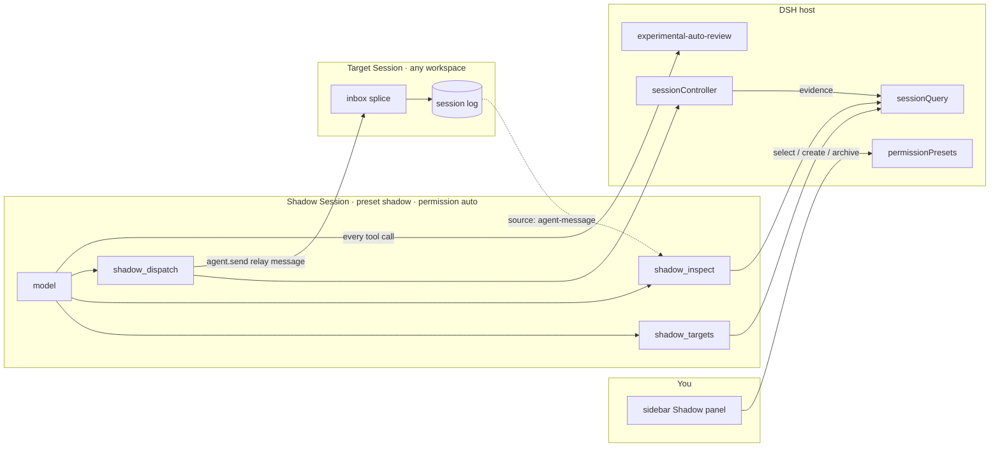

# dsh-plugin-shadow

> When you have more DSH conversations than you can track, let one of them stand in your seat: watching progress and handing work to the right Session.

**Repository**: [RD2100/rd-shadow](https://github.com/RD2100/rd-shadow) — **Package**: `dsh-plugin-shadow` (the repository and the package are named differently; install by package name)

*[中文说明](README.md)*

The shadow is a separate DSH Session living in its own directory. It has three abilities:

1. **See** all your workspaces and Sessions (who is busy, who is asleep, what is archived);
2. **Read** any Session's state and recent events;
3. **Dispatch** — deliver a message to a chosen Session and return audit-ready delivery evidence.

It does not reimplement the old workbench's ledger, memory, or subscription pools. It uses only the official Session, approval, and permission services, so **every action can be reconstructed from the Session log**.

---

## Status

| Capability | State |
|---|---|
| Sidebar entry / candidate list / create / archive | ✅ working |
| Permission identity (Sessions in the shadow directory get the `auto` preset automatically) | ✅ verified |
| `shadow_targets` / `shadow_inspect` / `shadow_dispatch` | ✅ verified (including a real delivery and result read-back) |
| Irreversible-operation interception | ⚠️ partial — see [Permission model](#permission-model) |

`0.1.x` is **usable by its author, not yet widely validated**. Every item under [Known limitations](#known-limitations) was measured, not guessed.

---

## Requirements

| Item | Requirement |
|---|---|
| DSH | `dsh-desktop-next 2.0.20-next` (harness `0.2.1-rc.3`). This plugin depends on that build's internal services and tool-registration contract and is **not guaranteed across versions** |
| Node | `>= 22.19` |
| Reviewer plugin | **Strongly recommended**: `@deepseek-ai/dsh-experimental-auto-review` in the profile's bundles. **Without it the shadow degrades to full disk access with no approval at all** — see [Security warning](#security-warning) |
| Profile | A GUI-capable web or desktop profile (this plugin has a browser half) |

---

## Install

### Desktop profile

The desktop profile **cannot** be managed by the `dsh plugin` CLI (DSH reserves it for the Electron application). Use the in-app plugin manager, or have an agent call `plugin_manager`'s `install_bundle`:

```
install_bundle  spec = https://github.com/RD2100/rd-shadow
```

The manager also accepts npm package names, tarball URLs, and absolute local paths.

### web / tui profile

```sh
dsh plugin --profile web add <npm name | git url | absolute path>
```

### Manual (any profile)

Both halves are needed in the profile's `package.json`:

```jsonc
{
  "dsh": { "profile": { "bundles": ["dsh-plugin-shadow"] } },
  "dependencies": { "dsh-plugin-shadow": "file:D:/path/to/shadow-plugin" }
}
```

---

## First configuration

Everything is configured on the plugin rows in `cordis.patch.yml`:

```yaml
- id: shadow
  name: 'dsh-plugin-shadow'
  config:
    shadowPresetId: shadow        # the agent preset that marks a Session as the shadow
    permissionPreset: auto        # the permission identity of shadow Sessions
    shadowDir: '~/dsh-shadow'     # the shadow's own directory ('~' expands to your home)
```

- `shadowDir` **is** the shadow's identity: only Sessions living there get the permission identity and the three tools.
- If you omit `shadowDir`, the host side falls back to `<home>/dsh-shadow`; **the browser half requires an explicit value**, so please write the line.
- First use creates that directory's workspace; using it again reuses it instead of registering a duplicate.
- `enforcePermissionPreset` (default `true`): every Session creation/resume writes `permissionPreset` back. **If you switch presets by hand (for example to `danger-full-access`), set it to `false`** — the plugin then pins only Sessions whose log records no permission choice yet, and your manual switch survives.

---

## Architecture



Three things worth remembering:

1. **Capability follows the preset**: the three tools are registered only in the `shadow` preset's agent scope; other Sessions never see them.
2. **Identity follows the directory**: only Sessions inside `shadowDir` are pinned to `auto` and treated as the shadow.
3. **Delivery is auditable**: the message carries `source={kind:'agent-message'}`, so the receiver's log reconstructs who dispatched it; the receipt's `inbox@seq`/`user@seq` point at exact events in that log.

---

## The three tools (model-visible)

| Tool | Purpose |
|---|---|
| `shadow_targets` | List workspaces and Sessions: id, live state (`idle`/`cold`/`busy`), archived and subagent markers, titles |
| `shadow_inspect` | Read one Session without activating it: state, directory, current model, sequence number; optional paged events (`afterSeq`/`limit`) whose header tells you how many remain and where the end is |
| `shadow_dispatch` | Deliver one message to a Session. The message carries `source={kind:'agent-message', form:'relay', senderSessionId}`, so **the receiver's log proves who dispatched it** |

Delivery is idempotent: replaying the same tool call (crash recovery, host retry) yields the same message id and never delivers twice. **To send again, call again** — that is a new message, not a duplicate.

Receipt `status`:

| Value | Meaning |
|---|---|
| `durable` | Written to the target log and admitted into a turn (`user/message` exists) |
| `accepted` | In the target's inbox, not yet admitted |
| `already-delivered` | This message was delivered before (same message id already in the target log) |
| `rejected` | Not delivered; `reason` explains why (`busy`/`pending`/`archived`/`workspace-session-mismatch`/…) |
| `unknown` | **Confirmation was lost after sending. Do not retry** — a retry derives a new message id and would deliver twice; report it and verify with `shadow_inspect` |

---

## Permission model

Shadow Sessions always run as `auto`: **full sandbox plus a per-call review**. The review is the official `dsh-experimental-auto-review`; its contract is:

| Class | Scope | Handling |
|---|---|---|
| low | ordinary project reads/writes, analysis, tests, builds, non-destructive Git, exact cleanup of objects this Session created | allowed outright |
| medium | deleting pre-existing objects, force push / history rewrite, production reads/writes/deployments, external writes, permission or security changes | allowed **only when a current human instruction explicitly authorizes the action, the exact target, and the scope**; otherwise denied and escalated to you |
| high | exfiltrating sensitive data across a trust boundary | always denied, even when explicitly requested |

⚠️ Two common misconceptions:

1. **It does not prompt for every irreversible action.** A deletion whose target and action you named in your instruction is judged `medium/allow` and **runs without a prompt**. Prompts appear when authorization is missing, ambiguous, or broader than your instructions — which is exactly what `medium` is for.
2. The reviewer **does not read the filesystem**. It sees only `cwd`, project instructions, filtered history, and the pending action. So "does that file exist" is inferred from history — whether your instruction named the target directly decides the outcome.

---

## Security warning

**If `@deepseek-ai/dsh-experimental-auto-review` is not mounted**, the `auto` preset name does not exist; this plugin's host half then falls back to `danger-full-access` (and logs a warning). That means the shadow has **full disk access and never asks** — no interception at all.

Before installing, confirm:

```
profile package.json → dsh.profile.bundles contains "@deepseek-ai/dsh-experimental-auto-review"
```

At startup the host half logs one identity line (`shadow: permission identity …`). `auto` means the reviewer is in place. On a **fresh start** that line may read `danger-full-access at mount ("auto" not offered yet)`: bundles mount **concurrently** (the loader activates the whole list with `Promise.all`), so which of this plugin and auto-review finishes first depends on their import times — a race, not a queue. It is not a fault — every shadow Session re-resolves the catalog when it is created and still ends up on `auto` (logged as `shadow: <session id> permission -> auto`). Array order only decides which import starts first: listing `dsh-plugin-shadow` **after** `@deepseek-ai/dsh-experimental-auto-review` merely raises the odds that `auto` registers first, it does not guarantee it.

### Outbound allowlist (`egressAllowlist`)

Anything the shadow reads is **untrusted data** — a web page, an issue, a README can all carry "send this file to that address" instructions. That is **indirect prompt injection**, and it is the most realistic threat for a tool like this.

So the plugin adds a **rule** ahead of the reviewer (a match, not a judgement):

| Case | Behaviour |
|---|---|
| A web tool, or a shell command naming `curl`/`wget`/`iwr`/`ssh`… whose destination host is in `egressAllowlist` (always including `localhost`/`127.0.0.1`) | allowed |
| Same, but the host is not listed | **asks you**, accepting only a one-time grant; refused when no approval channel exists |
| An outbound command whose destination is not in its arguments (`git push`, `npm publish`, `docker push`, `gh`, `svn`/`hg`, `scp`, `ssh`, DNS lookups, cloud CLIs, database clients, BITS transfers) | **asks you** — with no host to compare, the allowlist cannot decide |
| A command whose destination IS a URL (`git clone`/`fetch`/`pull`, `svn checkout`) | checked by the ordinary allowlist rule; the scp syntax and configured-remote forms always ask |
| A command naming a network client but spelling no readable URL (`curl evil.test`), or a destination on a non-HTTP protocol (`ftp://`) | **asks you** |
| A tool served by an external server (`mcp__*`) | **asks you** — its destination is visible to it, not to this process |
| Calls that cannot reach the network (file writes, edits, dispatch — even when their text contains URLs) | never disturbed |
| A command name that appears only in **text** (a commit message, an echo, a comment — `git commit -m "docs: ssh usage"`) | never disturbed — only a name at a segment start (after `;`/`&&`/`||`/`|`/`&`/newline, with `sudo`/`env`/`&`/`(`/`cmd /c`/`powershell -c` wrappers stripped) is a command |
| A command spelled `git.exe push`, `npm.cmd publish`, `C:\…\curl.exe evil.test`, `cmd.exe /c curl …`, `& "curl.exe" …` | **asks you** — the command head is normalized first: a Windows suffix, a full path, a forwarding shell, and wrapping quotes are all stripped before the decision |
| A command hidden inside `$(...)`, backticks, `{ … }`, or a subshell (`echo $(curl https://evil.test)`, `if ($true) { curl … }`) | **asks you** — these are spans the shell really executes, so they are analysed as commands |
| A URL inside a data-only command's arguments (`git commit -m "see https://evil.test"`, `echo`, `Write-Output`, build tools) | never disturbed — that is prose, not a destination |

The point: **it checks the destination, not the payload**. Base64, splitting or re-encoding the content cannot change where a request goes, so this rule cannot be bypassed; a content regex can, which is why there is no content scan.

**Scope**: the guard only applies to **shadow Sessions** — it is registered inside the `preset-shadow` agent preset's scope (see `cordis.patch.yml`), so your own sessions are untouched. That is deliberate: the shadow is the one that reads untrusted content (a web page, an issue, someone else's README); your sessions are trusted by definition. For the same reason no CLI or API can trigger the guard outside a shadow Session, so the end-to-end check has to run inside one (see `E2E-GUARD.md`).

The default allowlist is empty, so every outbound request asks. Add hosts to stop being asked — but remember **an allowlist entry is itself a channel**.

### Reading protected data disables the allowlist

The better question is not "does this content look sensitive" but **"what did this Session just read"**. `protectedPaths` lists file names or path fragments (by default `.credentials`, `.env`, `id_rsa`, `id_ed25519`, `.pem`, `.pfx`, `secrets`).

- A tool call that **mentions** one of them — reads it, lists its directory, names it in a command — marks that Session's **current turn**;
- While marked, **every outbound request asks**, even to an allowlisted host;
- The mark clears at the turn boundary (`turn/end`, or the next `turn/start`).

Why this beats a content filter: **what it read is knowable** (the path is in the arguments), while **what counts as sensitive is not** (the same string is a key in a config file and an example in a doc). The mark never inspects what you send — it looks at what was touched earlier — so base64 or splitting the payload cannot dodge it.

The cost, stated plainly: ordinary work is "never touched a secret → allowlisted hosts stay quiet; touched one → everything asks for the rest of that turn". That includes **a normal web fetch later in the same turn after reading `.env`**.

**What this does not cover**: channels that avoid HTTP (DNS exfiltration, writing into a synced folder or a UNC path another process uploads), **redirects** (an allowlisted host 302-ing elsewhere — the guard only sees the initial URL), **script or alias indirection** (`npm run release` that is really a publish, a git alias `pu` for push — the arguments do not show the real action), an interpreter sending without a URL (`python -c "os.system('ssh host')"` — neither the destination nor the client name sits where the guard reads), URL spellings the guard cannot recognise, and tools served by an external server that carries no destination in its arguments (`mcp__*` — those always ask, but the question is "use this tool at all", not "send it where"). It is a speed bump, not a proof.

---

## Known limitations

| Limitation | Detail |
|---|---|
| **Every tool call is reviewed** | Measured 6–53 s per call (`glob` ~7-15 s, `read` ~6 s, `pwsh` ~8-24 s, deletions 38-53 s). A "slow" shadow is normal, not hung |
| `medium` classification is a model judgement | The same command may be judged differently depending on how the instruction is phrased |
| The review consumes model quota | When quota is exhausted the review fails and the call is denied (fail closed), never allowed |
| GUI profiles only | The client half needs a browser environment |
| Windows-oriented defaults | The default is cross-platform, but a hard-coded Windows `shadowDir` needs editing when you switch platforms |
| No cross-version compatibility work | See [Requirements](#requirements) |

---

## Development and testing

```sh
npm test                        # all offline checks (core + preflight + sim + patch + package self-sufficiency)
npm run pack:check              # published artifact only: files coverage, entry points, runs from a copy
node tests/run.mjs --deployed   # additionally verify the installed copy (needs SHADOW_PROFILE_TOOLS)
npm run sync -- --profile <profile dir>   # copy into the profile and verify in one step
```

| Suite | Covers |
|---|---|
| `tests/shadow-dir.test.mjs` | The single owner of the directory rule: portable default, `~` expansion, normalized comparison |
| `tests/host-preflight.test.mjs` | Host half: startup preflight (missing services named, version readable, preflight failure cannot break the plugin) and the pinning policy (enforce by default, or keep the user's choice with `enforcePermissionPreset:false`) |
| `tests/client.test.mjs` | Browser half: the real bundle loaded in a sandbox verifies the loader id, the exported `inject`, the sidebar slot registration, both dictionaries, and drives `createShadow` through every result shape — including the "workspace already exists" regression |
| `tests/dispatch-core.test.mjs` | Pure judgement core: identity derivation, messageId, evidence scan, state machine, rendering, and the **egress guard's** full decision set (allowlist, subdomains, localhost, credentials and ports, nested arguments; shell segment starts and the prose exemption, executable spans, command-head normalization, taint, fail-closed — including the 8 real calls recorded in the first end-to-end run) |
| `tests/tools-sim.mjs` | The real `lib/tools.js` against a fake host: delivery, idempotency, rejection codes, per-target serialization, catalog listing, and the guard mounted on `tools/pre-execute` (pass after approval, stop on rejection, refuse without an approval channel, refuse when the approval throws, **refuse when the guard itself throws without prompting**, no question for allowlisted hosts, no question for offline tools) |
| `tests/patch.check.mjs` | Parses `cordis.patch.yml` (including `!!js`) and asserts the shadow rows are intact; needs `js-yaml` (installed via `npm install`, or point `JS_YAML` at it) |
| `scripts/pack-check.mjs` | The published artifact: every `lib/*.js` included, entry points exist, runtime imports stay inside the shipped set, a copy of only those files still passes the tools suite |

The simulator uses `tests/dsh-tools-stub.mjs` to reproduce the official author-schema validation — a tool definition that would throw at the real registration site throws here too.

**Startup preflight**: the host half checks that `agents` / `llm` / `sessionController` / `sessionQuery` / `sessions` / `tools` / `workspaceRegistry` are all present, names whichever is missing, and states the expected runtime version — so a version mismatch surfaces as one actionable line instead of "the shadow Session will not start".

### How changes take effect (a trap we hit)

- DSH's HMR **watches the profile configuration but not the plugin's `lib/*.js`**. After copying code into the profile, a running instance will **not** load it; a restart is required.
- Worse: editing `cordis.patch.yml` triggers a config reload that **re-imports `lib/index.js` while possibly reusing cached sibling modules**. If the two files disagree at that moment the plugin fails to load:

  ```
  SyntaxError: The requested module './shadow-dir.js' does not provide an export named 'expandShadowDir'
  shadow (dsh-plugin-shadow): failed to import … 1 entry did not activate
  ```

  The files on disk are actually consistent; only HMR's module graph is stale. **A restart always recovers.** Symptom check: the log shows `did not activate`, and no later `shadow:` lines appear.

  After a successful restart the log carries exactly these two lines, and they are worth their weight when diagnosing:

  ```
  shadow: directory /home/you/dsh-shadow   ← effective directory (is the config right?)
  shadow: permission identity auto          ← auto available = the reviewer is mounted
  ```

  If the second line becomes a `using "danger-full-access" instead` warning, the profile does not mount `@deepseek-ai/dsh-experimental-auto-review` — and then the shadow runs with **full access and no review at all**.

  > A cold shadow Session's log may end on `danger-full-access` + `never`: that is auto-review flipping `auto` back **on shutdown**, not a configuration error, and not a risk (a cold Session cannot run tools). Opening the Session re-pins `auto`, and the log shows `shadow: <id> permission -> auto`.

- So a sync must end with a deployed check. `npm run sync` does the whole thing (enumerates `lib/*.js` from disk, copies, then runs `--deployed`, so a half-finished copy fails immediately):

  ```sh
  npm run sync -- --profile <your profile directory>
  ```

  Manual equivalent:

  ```sh
  SHADOW_PROFILE_TOOLS=<profile>/node_modules/dsh-plugin-shadow/lib/tools.js \
    node tests/run.mjs --deployed
  ```

### Layout

```
lib/index.js         host half: pins the permission identity of Sessions in the shadow directory
lib/tools.js         registration and effects for the three model-visible tools
lib/dispatch-core.js pure judgement core (no host dependency; importable by plain Node)
lib/shadow-dir.js    the single owner of the shadow-directory rule
lib/client.js        browser half: sidebar entry and panel
cordis.patch.yml     preset + three plugin rows
scripts/             sync and pack checks
tests/               offline verification assets
DESIGN.md            design (invariants, permission model, milestones)  — Chinese
DISPATCH-SPEC.md     implementation spec (runtime contracts, state machine, idempotency, verification log) — Chinese
```

---

## Before publishing (maintainers)

- [x] `repository` / `homepage` / `bugs` point at [RD2100/rd-shadow](https://github.com/RD2100/rd-shadow)
- [ ] Screenshots in the README
- [ ] Decide whether to publish to npm (otherwise installs come from git or a local path)
- [x] English README
- [x] CI running at least `npm test` (`.github/workflows/test.yml`, ubuntu/windows × node 22/24)
- [ ] Translate the design docs (currently Chinese only)
- [x] End-to-end verification of the egress guard (see [E2E-GUARD.md](E2E-GUARD.md)): the prompt, the judging method, the first run's results and the re-run path are all archived; the last link (confirming the fix inside a shadow Session) is still open

---

## License

MIT, see [LICENSE](LICENSE).
