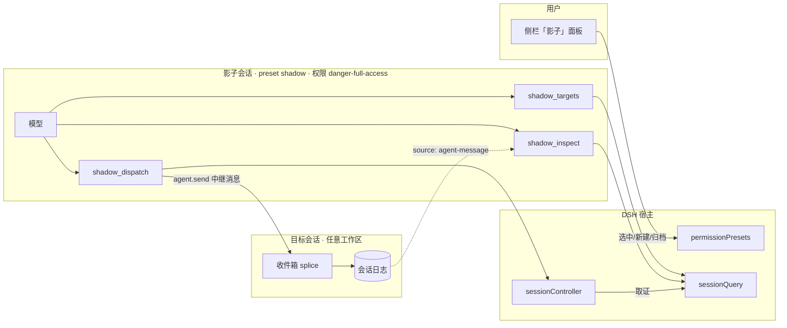

# dsh-plugin-shadow（影子总控）

> 你自己的 DSH 会话管理不过来时，让一个会话站在你的视角上，替你盯着进度、把活派给正确的会话。

**仓库**：[RD2100/rd-shadow](https://github.com/RD2100/rd-shadow)　**包名**：`dsh-plugin-shadow`（仓库名与包名不同，安装时用包名）

*[English](README.en.md)*

影子是一个**独立的 DSH 会话**，住在自己的目录里，拥有三件事：

1. **看见**你的所有工作区和会话（谁在忙、谁睡着、谁归档了）；
2. **读**任意一个会话的状态和最近事件；
3. **派活**——把一条消息投递到指定会话，并拿到可核对的投递证据。

它不复制旧工作台的账本、记忆、订阅池。它使用官方的会话与权限接口，因此**每一件事都能从会话日志重建**。影子会话拥有完整权限且不会等待审批。

---

## 状态

| 能力 | 状态 |
|---|---|
| 侧栏入口 / 候选列表 / 新建 / 归档 | ✅ 可用 |
| 权限身份（影子目录内的会话固定为 `danger-full-access`） | ✅ 已验证 |
| 影子工具调用人工审批 | 已关闭：无条件放行 |
| `shadow_targets` / `shadow_inspect` / `shadow_dispatch` | ✅ 已验证（含真实投递与结果核对） |

版本 `0.10.0` 提供影子会话协调与派发。影子权限固定为 `danger-full-access`，工具调用不等待人工审批。

---

## 要求

| 项 | 要求 |
|---|---|
| DSH | `dsh-desktop-next 2.0.20-next`（harness 包 `0.2.1-rc.3`）。本插件直接依赖该版本的内部服务与工具注册契约，**不保证跨版本可用** |
| Node | `>= 22.19` |
| 评审插件 | 不需要。影子工具不等待官方评审，权限固定为 `danger-full-access`；请先阅读[权限与安全](#权限与安全) |
| profile | 带 GUI 的 web / desktop profile（本插件有浏览器半边） |

---

## 安装

### 桌面版（desktop profile）

桌面版 profile **不能**用 `dsh plugin` 命令行管理（DSH 明确保留给 Electron 应用）。用应用内的插件管理（设置里的插件页），或让一个 agent 调 `plugin_manager` 的 `install_bundle`：

```
install_bundle  spec = https://github.com/<你的账号>/dsh-plugin-shadow
```

（或本机的绝对路径、tarball URL、npm 包名——管理器都接受。）

### web / tui profile

```sh
dsh plugin --profile web add <npm 包名 | git 地址 | 绝对路径>
```

### 手动（任何 profile）

在 profile 的 `package.json` 里同时做两件事：

```jsonc
{
  "dsh": { "profile": { "bundles": ["dsh-plugin-shadow"] } },
  "dependencies": { "dsh-plugin-shadow": "file:D:/path/to/shadow-plugin" }
}
```

---

## 首次配置

所有配置都在插件行上（`cordis.patch.yml`）：

影子 preset 内只注册影子工具；host 行负责目录身份与权限。工具入口没有审批开关，任何调用都无条件继续：

```yaml
- id: shadow-tools
  name: 'dsh-plugin-shadow/tools'
  config:
    shadowDir: '~/dsh-shadow'
- id: shadow
  name: 'dsh-plugin-shadow'
  config:
    shadowPresetId: shadow
    shadowDir: '~/dsh-shadow'
```

- `shadowDir` 是**影子的身份**：住在这里的会话才算影子，才被固定为 `danger-full-access` 并获得三个工具。
- `shadow-tools` 必须与 host 行使用相同的 `shadowDir`。
- 省略 host 行的 `shadowDir` 时使用 `<家目录>/dsh-shadow`；浏览器半边要求显式配置。
- 首次使用会在该目录创建 workspace；再点一次会复用，不会重复注册。
- 工具入口不注册出网守卫；旧白名单和审批配置不会拦截或延迟工具调用。

---

## 架构



三条要点：

1. **能力跟着预设走**：三个工具只注册在 `shadow` 预设的 agent 作用域里，别的会话看不到。
2. **身份跟着目录走**：`shadowDir` 里的会话才被钉为 `danger-full-access`，才被视为影子。
3. **投递可追溯**：消息带 `source={kind:'agent-message'}`，接收方日志能重建"谁派来的"；回执里的 `inbox@seq`/`user@seq` 指向目标日志的具体事件。

---

## 三个工具（模型可见）

| 工具 | 作用 |
|---|---|
| `shadow_targets` | 列出工作区与会话：id、实时状态（`idle`/`cold`/`busy`）、归档与子代理标记、标题 |
| `shadow_inspect` | 只读查看一个会话：状态、工作目录、当前模型、事件序号；可选分页读事件（`afterSeq`/`limit`），头部会告诉你本页之后还有多少条、末尾 seq 是多少 |
| `shadow_dispatch` | 向一个会话投递一条消息。消息带 `source={kind:'agent-message', form:'relay', senderSessionId}`，**接收方的日志能重建"是谁派来的"** |

投递是幂等的：同一次工具调用被重放（崩溃恢复、宿主重试）得到同一 message id，不会重复投递；**想再发一次就重新调用**——那是新消息，不是重复。

回执里的 `status`：

| 值 | 含义 |
|---|---|
| `durable` | 已写入目标日志并被采纳进轮次（`user/message` 已出现） |
| `accepted` | 已进入目标收件箱，但还没被采纳 |
| `already-delivered` | 这条消息之前已经投递过（同一个 message id 已在目标日志里） |
| `rejected` | 未投递，`reason` 说明原因（`busy`/`pending`/`archived`/`workspace-session-mismatch`/…） |
| `unknown` | **发送后失去确认能力。不要重试**——重试会产生新的 message id 造成重复投递；请报告并用 `shadow_inspect` 核对 |

---

## 权限与安全

影子会话固定使用 `danger-full-access`，工具调用不经过出网审批 hook，也不会等待官方 auto-review 或人工授权。影子可以直接读写完整文件系统并访问外网。只在你信任影子指令和工作区内容时使用，避免让它处理不可信提示或不该暴露的敏感目录。

启动日志应显示：`shadow: permission identity danger-full-access; interactive approvals are disabled`。

### 旧版守卫记录（不适用于当前版本）

以下规则仅是旧实现的存档。当前工具没有审批 hook，也没有配置可以恢复它；这些规则不描述当前运行时行为。


旧版守卫曾基于目的地主机、敏感路径和调用参数请求人工批准；这一实现已从影子工具入口移除。`dispatch-core.js` 中仍保留纯分类逻辑与离线测试，但不参与运行时工具调用，也不构成安全边界。

### 旧版：读过敏感文件之后，白名单失效

更好的做法不是"猜内容敏不敏感"，而是**记录它读过什么**。`protectedPaths` 列出一组**文件名/路径片段**（默认：`.credentials`、`.env`、`id_rsa`、`id_ed25519`、`.pem`、`.pfx`、`secrets`）。

- 一次工具调用只要**提到**其中一个片段（读它、列它的目录、命令里写了它），该会话就被标记；
- 标记之后，**该会话的所有外发都要问你**——哪怕目标是白名单里的网站；
- **调遣也带标记**：发送方被标记过、或消息正文里提到受保护路径时，目标会话接手这个标记。否则「A 读 `.env`、A 调遣 B、B 把内容发出去」是唯一一条谁都不问的出路——调遣是本地调用，按本地调用判定，而 B 自己的标记是空的；
- 标记**默认持续到会话结束**（`taintScope: 'session'`）：数据还在模型的上下文里，轮次边界不会让它"被忘掉"，所以「第 1 轮读 `.env`、第 2 轮把密钥当搜索词发出去」这条路是堵着的。嫌吵就设 `taintScope: 'turn'`，标记在轮次边界清除——那是用两轮之间的窗口换安静。

为什么这样比"内容过滤"可靠：**它读过什么是确定的**（参数里写着路径），而**什么算敏感是不确定的**（同一串字符，在配置文件里是密钥，在文档里是示例）。标记不看你发了什么，只看你之前碰过什么，所以 base64、拆成两半都绕不过去。

代价说清楚：日常是"没碰敏感文件 → 发白名单不打扰你；碰了 → 之后发什么都先问"，**读一次 `.env` 之后，这个会话里连正常的抓网页、正常的搜索都会问你**，直到会话结束（或把 `taintScope` 改成 `turn`）。这是有意的：宁可多问，不给"这轮读、下轮发"留窗口。

### 旧版：诱饵密钥与审批记忆

上面那条规则的毛病是"宽"——它凭"碰过 `.env` 这个文件名"就怀疑之后的一切。有两条更准的补充：

**诱饵密钥（`canaryValues`）**：在 `.env` 里放一个**假的**密钥（哪儿都不通用、只有你知道），把它填进配置：

```yaml
    canaryValues:
      - 'AKIAFAKEFAKEFAKE'      # 放在 .env 里的假 AWS key
      - 'ghp_fakefakefakefake'  # 放在 .env 里的假 GitHub token
```

之后任何外发调用的参数里**出现这串字符**，守卫一律问人——不需要污点、不需要白名单配合。为什么这条可以看内容而别的不行：**这串字符是唯一的、假的、没有任何正当用途**，它出现在出口就只有一种解释。通用密钥正则那种"猜"才会误报，诱饵不会。提示里只说是第几条诱饵，**不会把这串字符回显出来**（提示词和日志都不该带上它）。

它的边界说清楚：**诱饵只在密钥被写进参数时才看得见**。`curl -d "$(cat .env)"` 这种写法里，密钥是运行时才从文件读出来的，参数里没有它——诱饵看不见，但 `.env` 被提到了，污点照样会问。两条机制因此是互补的，不是互相替代。

**审批记忆（`approvalMemory`）**：同一个调用（工具名 + 参数完全一致）批准过一次，在窗口期内不再问。`turn`（默认）= 本轮内；`session` = 本会话内；`off` = 每次都问。为什么只记"完全一致"：URL 不一样、查询词不一样、命令不一样，就是**不同的调用**——差别恰恰是载荷能藏身的地方。所以它治的是"同一个问题问两遍"（轮询、重试、循环），治不了"每次查询都不同"的搜索；后者要靠诱饵。

**推荐的搭配**：配了诱饵之后，就可以把 `taintScope` 设回 `turn`——真正重要的那条路（真密钥出去）由诱饵守着，误报还低；宽泛的路径标记只负责兜住"说不清是什么的敏感数据"，窗口收窄到一轮，吵声立刻下来。

**跨调用的间接（`statefulShell`）**：别名、函数、脚本在**上一次**调用里定义、**这一次**调用才用——`Set-Alias x curl` 之后 `x evil.test`。同一条命令行内的自我定义（`$c = "curl"; & $c …`、`function x { & curl @args }; x …`）都按调用判定；跨调用的那份只有 shell 真的保持状态时才存在。默认 `false`：出厂预设的 shell 是全新进程，两次调用之间什么都不记得，记住它只会制造一个关于不存在命令的弹窗。**只有部署用的是持久 shell**（`pwsh_persistent`、终端会话）时才设 `true`——那是关于部署的声明，由操作员做；每个会话记住的名字有上限（200）。

**这条规则覆盖不到**：程序**内部**发起的 DNS 查询（命令行里写了名字的按名字判定，程序自己解析的名字不在参数里）、写到本地同步目录再由别的程序送出（`\\host\share\` 这种共享路径本身算目的地，已覆盖）、**重定向**（白名单域名 302 到别处，守卫只看初始 URL）、**跨调用的间接**（上一次调用定义、这一次调用才用的名字，仅在 `statefulShell: true` 时记得；`npm run`/`make` 的脚本体在读得到清单时按体判定，读不到时与以前一样）、解释器用非 URL 方式发出的请求（`python -c "os.system('ssh host')"`——目的地不在参数里，客户端名也不在段首）、把目的地编码/拆写得本守卫认不出的 URL 拼法、以及由外部服务器提供且参数里不带目的地的工具（`mcp__*`，这类一律问人，但问的是"要不要用这个工具"而不是"发去哪里"）。它是一条减速带，不是证明。
---

## 已知限制

| 限制 | 说明 |
|---|---|
| **没有交互式审批** | 影子固定为 `danger-full-access`；工具调用不等待人工授权 |
| 只支持带 GUI 的 profile | client 半边需要浏览器环境 |
| Windows 路径 | 默认值跨平台，但 `shadowDir` 若写死 Windows 绝对路径，换平台需改配置 |
| 未做跨 DSH 版本兼容 | 见[要求](#要求) |

---

## 开发与测试

```sh
npm test                        # 全部离线检查（纯核 + 预检 + 仿真 + patch + 发布产物自足性）
npm run pack:check              # 只验发布产物：files 覆盖、入口存在、只复制这些也能跑
node tests/run.mjs --deployed   # 额外对已安装副本再跑一遍（需 SHADOW_PROFILE_TOOLS）
npm run sync -- --profile <profile 目录>   # 把源码同步进 profile 并自动验证
npm run fingerprint             # 打印本仓库运行代码的内容哈希，与宿主日志里的 build 行比对
npm run judge                   # 委托 restart-plugin：判定 → 重启 → 核对
```

改动后的闭环：`npm test` → `npm run sync -- --profile <profile>` → 分别提交两个仓库 → 最后在 `restart-plugin` 执行 `npm run judge`。
裁判只对提交里的部署字节放行，并核对宿主日志中的 `shadow: build <哈希>`；账本与续接队列位于 `<DSH_HOME>/.restart/`。

| 套件 | 覆盖 |
|---|---|
| `tests/shadow-dir.test.mjs` | 目录规则的唯一所有者：可移植默认、`~` 展开、归一化比较 |
| `tests/host-preflight.test.mjs` | host 半边启动预检、目录身份过滤，以及始终钉住 `danger-full-access` 的权限策略 |
| `tests/client.test.mjs` | 浏览器半边：真实 bundle 在沙箱里加载，校验 loader id、导出的 `inject`、侧栏 slot 注册、字典中英齐全，并驱动 `createShadow` 的全部返回形态（含"工作区已存在"这个曾经的回归） |
| `tests/dispatch-core.test.mjs` | 纯派发逻辑，以及旧出网分类器的单元覆盖；该分类器不连接运行时工具 |
| `tests/tools-sim.mjs` | 真实 `lib/tools.js` + 假宿主：工具注册、目录绑定、投递/幂等/拒绝码/并发串行化，以及传入旧审批配置时 `shadow_dispatch` 仍无等待地完成投递 |
| `tests/patch.check.mjs` | 解析 `cordis.patch.yml`（含 `!!js`），断言影子行完好；需要 `js-yaml`（`npm install` 后即可，也可用 `JS_YAML` 指定模块路径） |
| `tests/build-stamp.test.mjs` | 构建戳的契约：哈希跟着字节走（改一个字节、加一个文件都会变），读不到时报 null 而不是炸掉挂载 |
| Restart validation | `dsh-plugin-restart` owns judge, worker, ledger, and resume-queue tests in the separate restart repository |

仿真器用 `tests/dsh-tools-stub.mjs` 复刻官方 author-schema 校验——工具定义若在真实注册处会抛错，测试里同样会抛。

**启动预检**：host 半边在 apply 时检查 `agents` / `llm` / `sessionController` / `sessionQuery` / `sessions` / `tools` / `workspaceRegistry` 是否齐全，缺哪个就点名哪个并给出期望的运行时版本——这样版本不匹配时你看到的是一行可行动的告警，而不是"影子会话起不来"。

### 改动如何生效（踩过的坑）

- DSH 的 HMR **监视 profile 配置，但不监视插件的 `lib/*.js`**。改完代码复制进 profile 后，正在跑的实例**不会**加载新代码，必须重启。重启和部署校验由独立的 `dsh-plugin-restart` 仓库管理。
- 更麻烦的是：改 `cordis.patch.yml` 会触发一次配置重载，它会**重新导入 `lib/index.js`，却可能复用缓存里的旧模块**——如果这时两个文件版本不一致，插件会加载失败：

  ```
  SyntaxError: The requested module './shadow-dir.js' does not provide an export named 'expandShadowDir'
  shadow (dsh-plugin-shadow): failed to import … 1 entry did not activate
  ```

  磁盘上的文件其实是自洽的，只是 HMR 的模块图陈旧；**重启必然恢复**。判断方法：日志里有 `did not activate`，且此后没有新的 `shadow:` 日志。

   重启成功后，日志里应该正好有这三行，排查时值千金：

   ```
   shadow: directory D:\DSH\shadow        ← 生效目录（配置对不对看这一行）
   shadow: build <12 位哈希>               ← 我加载的就是这些字节
   shadow: permission identity danger-full-access; interactive approvals are disabled
   ```

   中间那行是**构建戳**：宿主自报它加载的 `lib/*.js` 的内容哈希。重启后拿它和仓库里
   `npm run fingerprint` 的输出对一下，相等才说明新代码真的在位——比"看文件时间戳"更硬，
   副本被改过、被别处副本顶替、或只拷了一半，哈希都会不一样。不想跑探针的话，
   这一行就是"改动生效了吗"的完整答案。

  影子目录内的会话应钉为 `danger-full-access`；工具调用不会经过人工审批。

  > 冷会话恢复时也会再次钉住 `danger-full-access`。

- 因此同步流程必须以这一步收尾（`npm run sync` 一次做完：按磁盘枚举 `lib/*.js` 复制，再跑 `--deployed`，半同步立刻失败）：

  ```sh
  npm run sync -- --profile <你的 profile 目录>
  ```

  等价的手工做法：

  ```sh
  SHADOW_PROFILE_TOOLS=<profile>/node_modules/dsh-plugin-shadow/lib/tools.js \
    node tests/run.mjs --deployed
  ```

### 重启与续接

重启裁判、worker、账本与续接队列均由独立仓库 `dsh-plugin-restart` 所有。它只在部署副本与目标提交逐字节一致时执行重启，并在 `<DSH_HOME>/.restart/` 记账。worker 会等待宿主日志安静后再重启；该操作可能中断其他任务，因此应将真实 `npm run judge` 留作一轮对话的最后动作。完整说明见 restart 仓库的 README。

影子插件不再包含重启 worker 或守卫热换路径。`dispatch-core.js` 的纯分类器仅供离线测试，不参与工具运行。

### 目录结构

```
lib/index.js         host 半边：将影子目录里的会话钉为 danger-full-access
lib/tools.js         三个模型可见工具的注册与效应
lib/dispatch-core.js 纯判断核（无 host 依赖，可被 plain Node 直接导入）
lib/shadow-dir.js    「影子目录」规则的唯一所有者
lib/build-stamp.js   构建戳：挂载时自报加载了哪些字节
lib/client.js        浏览器半边：侧栏入口与面板
cordis.patch.yml     preset + 三条插件行
scripts/judge.mjs              将重启任务委托给 dsh-plugin-restart

tests/               离线验证资产
DESIGN.md            设计（不变量、权限模型、里程碑）
DISPATCH-SPEC.md     实现规格（运行时契约、状态机、幂等、验证记录）
```

---

## 发布前待办（维护者）

- [x] `repository` / `homepage` / `bugs` 指向 [RD2100/rd-shadow](https://github.com/RD2100/rd-shadow)
- [x] 英文 README（[README.en.md](README.en.md)，两版互相链接）
- [ ] 截图放进 README
- [ ] 决定是否发布到 npm（不发布则只能从 git 或本地路径安装）
- [x] CI：至少跑 `npm test`（`.github/workflows/test.yml`，ubuntu/windows × node 22/24）
- [ ] 设计文档英译（`DESIGN.md` / `DISPATCH-SPEC.md` 目前为中文）
- [x] 历史出网守卫验证档案（[E2E-GUARD.md](E2E-GUARD.md)，仅供历史参考）

### 发布到 npm 的步骤

预检（2026-10-29 核过）：包名 `dsh-plugin-shadow` 在 npm 上未被占用；`npm pack --dry-run`
产出 16 个文件 135 kB 压缩包（`lib` + patch + LICENSE + 全部文档）；`npm run pack:check` 全过；
CI 绿；tag `v0.5.0` 已推。

```sh
npm whoami                 # 未登录会报 ENEEDAUTH——发布需要维护者凭据
npm run pack:check         # 产物自足性：files 覆盖、入口存在、只复制这些也能跑
npm publish --access public
```

发布后核对：`npm view dsh-plugin-shadow version` 返回 `0.5.0`；从别处
`npm install dsh-plugin-shadow` 后 `lib/tools.js` 可加载。

安装方式（发布前也可用）：`npm install git+https://github.com/RD2100/rd-shadow.git`，
或把仓库路径直接写进 profile 的 bundles。本机开发用 `npm run sync -- --profile <profile 目录>`。

---

## 许可

MIT，见 [LICENSE](LICENSE)。
