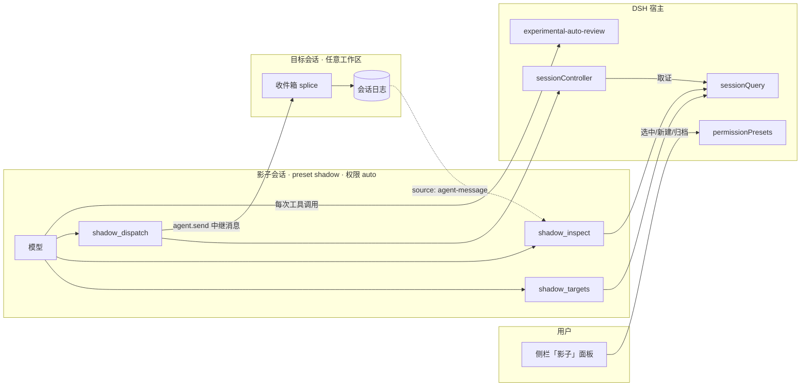

# dsh-plugin-shadow（影子总控）

> 你自己的 DSH 会话管理不过来时，让一个会话站在你的视角上，替你盯着进度、把活派给正确的会话。

**仓库**：[RD2100/rd-shadow](https://github.com/RD2100/rd-shadow)　**包名**：`dsh-plugin-shadow`（仓库名与包名不同，安装时用包名）

*[English](README.en.md)*

影子是一个**独立的 DSH 会话**，住在自己的目录里，拥有三件事：

1. **看见**你的所有工作区和会话（谁在忙、谁睡着、谁归档了）；
2. **读**任意一个会话的状态和最近事件；
3. **派活**——把一条消息投递到指定会话，并拿到可核对的投递证据。

它不复制旧工作台的账本、记忆、订阅池。它只用官方的会话、审批、权限接口，因此**每一件事都能从会话日志重建**。

---

## 状态

| 能力 | 状态 |
|---|---|
| 侧栏入口 / 候选列表 / 新建 / 归档 | ✅ 可用 |
| 权限身份（影子目录内的会话自动获得 `auto` 档） | ✅ 已验证 |
| `shadow_targets` / `shadow_inspect` / `shadow_dispatch` | ✅ 已验证（含真实投递与结果核对） |
| 不可逆操作拦截 | ⚠️ 部分——见[权限模型](#权限模型) |

版本 `0.1.x` 是**可自用、尚未广泛验证**的状态。下面[已知限制](#已知限制)里列的每一条都是实测出来的，不是猜测。

---

## 要求

| 项 | 要求 |
|---|---|
| DSH | `dsh-desktop-next 2.0.20-next`（harness 包 `0.2.1-rc.3`）。本插件直接依赖该版本的内部服务与工具注册契约，**不保证跨版本可用** |
| Node | `>= 22.19` |
| 评审插件 | **强烈建议**在 profile 的 bundles 里包含 `@deepseek-ai/dsh-experimental-auto-review`。**没有它，影子会退化成"全盘读写 + 永不审批"**，见[安全警告](#安全警告) |
| profile | 带 GUI 的 web / desktop profile（本插件有浏览器半边） |

---

## 安装

### 桌面版（desktop profile）

桌面版 profile **不能**用 `dsh plugin` 命令行管理（DSH 明确保留给 Electron 应用）。用应用内的插件管理（设置里的插件页），或让一个 agent 调 `plugin_manager` 的 `install_bundle`：

```
install_bundle  spec = https://github.com/<你的账号>/dsh-plugin-shadow
```

（或本机的绝对路径、tarball URL、npm 包名——管理器都接受。）

### web / tui profile

```sh
dsh plugin --profile web add <npm 包名 | git 地址 | 绝对路径>
```

### 手动（任何 profile）

在 profile 的 `package.json` 里同时做两件事：

```jsonc
{
  "dsh": { "profile": { "bundles": ["dsh-plugin-shadow"] } },
  "dependencies": { "dsh-plugin-shadow": "file:D:/path/to/shadow-plugin" }
}
```

---

## 首次配置

所有配置都在插件行上（`cordis.patch.yml`）：

```yaml
- id: shadow
  name: 'dsh-plugin-shadow'
  config:
    shadowPresetId: shadow        # 标记影子身份用的 agent preset
    permissionPreset: auto        # 影子会话的权限身份
    shadowDir: '~/dsh-shadow'     # 影子自己的目录（`~` 会展开成家目录）
```

- `shadowDir` 是**影子的身份**：住在这里的会话才算影子，才拿到权限身份，才有那三个工具。
- 省略 `shadowDir` 时 host 侧用默认 `<家目录>/dsh-shadow`；**浏览器半边不支持默认值**，所以请显式写一行。
- 首次使用会在该目录创建 workspace；再点一次会复用，不会重复注册。
- `enforcePermissionPreset`（默认 `true`）：每次会话被创建/恢复都把权限改回 `permissionPreset`。**如果你会手动切 `danger-full-access`，把它设为 `false`**——那样插件只钉那些日志里还没有权限选择的会话，你的手动切换会被保留。

---

## 架构



三条要点：

1. **能力跟着预设走**：三个工具只注册在 `shadow` 预设的 agent 作用域里，别的会话看不到。
2. **身份跟着目录走**：`shadowDir` 里的会话才被钉 `auto`，才被视为影子。
3. **投递可追溯**：消息带 `source={kind:'agent-message'}`，接收方日志能重建"谁派来的"；回执里的 `inbox@seq`/`user@seq` 指向目标日志的具体事件。

---

## 三个工具（模型可见）

| 工具 | 作用 |
|---|---|
| `shadow_targets` | 列出工作区与会话：id、实时状态（`idle`/`cold`/`busy`）、归档与子代理标记、标题 |
| `shadow_inspect` | 只读查看一个会话：状态、工作目录、当前模型、事件序号；可选分页读事件（`afterSeq`/`limit`），头部会告诉你本页之后还有多少条、末尾 seq 是多少 |
| `shadow_dispatch` | 向一个会话投递一条消息。消息带 `source={kind:'agent-message', form:'relay', senderSessionId}`，**接收方的日志能重建"是谁派来的"** |

投递是幂等的：同一次工具调用被重放（崩溃恢复、宿主重试）得到同一 message id，不会重复投递；**想再发一次就重新调用**——那是新消息，不是重复。

回执里的 `status`：

| 值 | 含义 |
|---|---|
| `durable` | 已写入目标日志并被采纳进轮次（`user/message` 已出现） |
| `accepted` | 已进入目标收件箱，但还没被采纳 |
| `already-delivered` | 这条消息之前已经投递过（同一个 message id 已在目标日志里） |
| `rejected` | 未投递，`reason` 说明原因（`busy`/`pending`/`archived`/`workspace-session-mismatch`/…） |
| `unknown` | **发送后失去确认能力。不要重试**——重试会产生新的 message id 造成重复投递；请报告并用 `shadow_inspect` 核对 |

---

## 权限模型

影子会话的权限身份固定为 `auto`：**全盘沙箱 + 逐次评审**。评审是官方的 `dsh-experimental-auto-review`，它的契约是：

| 档 | 范围 | 处置 |
|---|---|---|
| low | 项目内普通读写、分析、测试、构建、非破坏性 Git、本会话自建对象的精确清理 | 直接放行 |
| medium | 删除既有对象、force push / 历史重写、生产访问或部署、对外写入、权限变更 | **仅当当前人类指令明确授权了「动作 + 确切目标 + 范围」**时放行；否则拒绝并转人工确认 |
| high | 跨信任边界外泄敏感信息 | 一律拒绝，即使你明确要求 |

⚠️ 注意两点常见误解：

1. **不是"每次不可逆都弹窗"**。你在指令里点名了目标和动作的删除，会被判 `medium/allow` **直接执行**。只有授权缺失、含糊或超出范围时才会弹窗（这正是 `medium` 的设计）。
2. 评审**不读文件系统**，它只看到 `cwd`、项目指令、过滤后的历史、待执行动作。所以"那个文件是否存在"靠历史推断——指令有没有点名目标，直接决定结果。

---

## 安全警告

**如果 profile 里没有挂载 `@deepseek-ai/dsh-experimental-auto-review`**，那么 `auto` 这个预设名不存在，本插件的 host 半边会退回到 `danger-full-access`（并在日志里 warn）。那意味着影子是**全盘读写 + 永不审批**——没有任何拦截。

装之前请确认：

```
profile 的 package.json → dsh.profile.bundles 里有 "@deepseek-ai/dsh-experimental-auto-review"
```

---

## 已知限制

| 限制 | 说明 |
|---|---|
| **每次工具调用都要过一次评审** | 实测单次 6–53 秒（`glob` ~7-15s、`read` ~6s、普通 `pwsh` ~8-24s、删除类 38-53s）。影子看起来"慢"是正常的，不是卡死 |
| `medium` 判定依赖模型判断 | 同一条命令，指令写法不同可能得到不同结果。这是官方评审的固有特性 |
| 评审需要模型额度 | 额度耗尽时评审失败 → 调用被拒（fail closed），不是放行 |
| 只支持带 GUI 的 profile | client 半边需要浏览器环境 |
| Windows 路径 | 默认值跨平台，但 `shadowDir` 若写死 Windows 绝对路径，换平台需改配置 |
| 未做跨 DSH 版本兼容 | 见[要求](#要求) |

---

## 开发与测试

```sh
npm test                        # 全部离线检查（纯核 + 预检 + 仿真 + patch + 发布产物自足性）
npm run pack:check              # 只验发布产物：files 覆盖、入口存在、只复制这些也能跑
node tests/run.mjs --deployed   # 额外对已安装副本再跑一遍（需 SHADOW_PROFILE_TOOLS）
npm run sync -- --profile <profile 目录>   # 把源码同步进 profile 并自动验证
```

| 套件 | 覆盖 |
|---|---|
| `tests/shadow-dir.test.mjs` | 目录规则的唯一所有者：可移植默认、`~` 展开、归一化比较 |
| `tests/host-preflight.test.mjs` | host 半边启动预检：生效目录、缺失服务被指名、版本不匹配可读、预检自身出错不影响插件 |
| `tests/dispatch-core.test.mjs` | 纯判断核：身份派生、messageId、证据扫描、状态机、渲染格式 |
| `tests/tools-sim.mjs` | 真实 `lib/tools.js` + 假宿主：投递/幂等/拒绝码/并发串行化/目录列举 |
| `tests/patch.check.mjs` | 解析 `cordis.patch.yml`（含 `!!js`），断言影子行完好；需要 `js-yaml`（`npm install` 后即可，也可用 `JS_YAML` 指定模块路径） |

仿真器用 `tests/dsh-tools-stub.mjs` 复刻官方 author-schema 校验——工具定义若在真实注册处会抛错，测试里同样会抛。

**启动预检**：host 半边在 apply 时检查 `agents` / `llm` / `sessionController` / `sessionQuery` / `sessions` / `tools` / `workspaceRegistry` 是否齐全，缺哪个就点名哪个并给出期望的运行时版本——这样版本不匹配时你看到的是一行可行动的告警，而不是"影子会话起不来"。

### 改动如何生效（踩过的坑）

- DSH 的 HMR **监视 profile 配置，但不监视插件的 `lib/*.js`**。改完代码复制进 profile 后，正在跑的实例**不会**加载新代码，必须重启。
- 更麻烦的是：改 `cordis.patch.yml` 会触发一次配置重载，它会**重新导入 `lib/index.js`，却可能复用缓存里的旧模块**——如果这时两个文件版本不一致，插件会加载失败：

  ```
  SyntaxError: The requested module './shadow-dir.js' does not provide an export named 'expandShadowDir'
  shadow (dsh-plugin-shadow): failed to import … 1 entry did not activate
  ```

  磁盘上的文件其实是自洽的，只是 HMR 的模块图陈旧；**重启必然恢复**。判断方法：日志里有 `did not activate`，且此后没有新的 `shadow:` 日志。

- 因此同步流程必须以这一步收尾（`npm run sync` 一次做完：按磁盘枚举 `lib/*.js` 复制，再跑 `--deployed`，半同步立刻失败）：

  ```sh
  npm run sync -- --profile <你的 profile 目录>
  ```

  等价的手工做法：

  ```sh
  SHADOW_PROFILE_TOOLS=<profile>/node_modules/dsh-plugin-shadow/lib/tools.js \
    node tests/run.mjs --deployed
  ```

### 目录结构

```
lib/index.js         host 半边：给影子目录里的会话钉权限身份
lib/tools.js         三个模型可见工具的注册与效应
lib/dispatch-core.js 纯判断核（无 host 依赖，可被 plain Node 直接导入）
lib/shadow-dir.js    「影子目录」规则的唯一所有者
lib/client.js        浏览器半边：侧栏入口与面板
cordis.patch.yml     preset + 三条插件行
tests/               离线验证资产
DESIGN.md            设计（不变量、权限模型、里程碑）
DISPATCH-SPEC.md     实现规格（运行时契约、状态机、幂等、验证记录）
```

---

## 发布前待办（维护者）

- [x] `repository` / `homepage` / `bugs` 指向 [RD2100/rd-shadow](https://github.com/RD2100/rd-shadow)
- [x] 英文 README（[README.en.md](README.en.md)，两版互相链接）
- [ ] 截图放进 README
- [ ] 决定是否发布到 npm（不发布则只能从 git 或本地路径安装）
- [ ] CI：至少跑 `npm test`
- [ ] 设计文档英译（`DESIGN.md` / `DISPATCH-SPEC.md` 目前为中文）

---

## 许可

MIT，见 [LICENSE](LICENSE)。
